# Taku 新手图文手册

从打开第一个应用，到创建、自动化和分享

**核对日期：2026 年 10 月 20 日｜实机：macOS、Taku 3.1.123、中文界面｜30 张实机截图**

这份手册结合 [Taku 官网](https://taku.ai/)、[官方更新记录](https://taku.ai/changelog)、[官方 X](https://x.com/TheTakuAI)、Publisher / Sites 官方文档，以及这台电脑上的实际界面整理。截图中的账号、额度、已安装应用和任务记录属于本机示例，不代表新账号默认状态。

**先说清楚：Taku 把 AI 对话、可运行的小应用、可复用 Skill、外部工具和任务管理放进一个桌面工作区。** 你可以直接让 AI 做事，也可以打开现成应用；需要长期使用的工具，可以做成 App；想发网址给别人使用，可以走 Site。

这份手册里的关键步骤都在真机上走过一遍：完整做完了 Taku 内置的 12 步新手引导，从零做出了第 7 节的“选题整理器”并逐项验收，记下了每一步实际扣了多少 credits，以及中途遇到的两个坑和解决办法。连接外部账号、公开发布 Skill / App / Site 涉及真实账号和公开内容，这些章节按官方文档和客户端界面写成，会在文中说明。

> **完全没接触过 Taku？先读第 0 节（是什么、电脑能不能装），再读第 1 节（费用）。** 第 20 节是常见问题。

> **最重要的一条省钱提醒：** 做 App 很费 credits，失败了也照样扣。实测用 L3 做成一个很简单的小工具花了 2,299 credits（约 7.7 美元）；用 L2 做另一个小工具跑了 1 小时没做成，也扣了 1,996。发出需求后要盯着，超过 30 分钟没交付就点“停止”。详见第 1.3 节和第 10.2 节。

> **你现在最适合的顺序：第 3 节打开一个现成 App → 第 5 节理解 @ 菜单 → 第 7 节做一个简单工具 → 第 12、13 节再看迁移与发布。** 第 14 节讲怎么把已经在别处做好的项目搬进来。

## 0. 开始之前：Taku 是什么、适合谁

### 0.1 一句话理解

Taku 官网的口号是 “Borrow brilliance, make it yours”，意思是：**借用别人已经跑通的 AI 做法，再改成你自己的。** 它把 AI 应用、Agent、Skill 和工作流做成桌面上点开就能用的工具，不需要你去 GitHub 拉代码、装依赖或配 API Key。

官网把使用过程分成四步：

| 动作 | 意思 | 本手册对应章节 |
| --- | --- | --- |
| Find 发现 | 在社区 / Marketplace 找现成作品 | 第 3 节 |
| Run 运行 | 安装后直接打开使用 | 第 3、6 节 |
| Remix 改造 | 在现成作品上改，或用一句话让 Agent 做新的 | 第 6、7 节 |
| Publish 发布 | 把自己的 App、Skill 或网站分享给别人 | 第 12、13、18 节 |

官网首页自报的规模是：每月约 120 万次运行、12,000+ 个应用与技能、3,400+ 位创作者。这些是官方宣传数字，不是第三方统计。

### 0.2 它和你用过的 AI 工具有什么不同

| 你熟悉的工具 | 主要用途 | Taku 的区别 |
| --- | --- | --- |
| ChatGPT、Claude 等聊天客户端 | 一问一答 | 把一次做成功的方法保存成能反复打开的 App 或 Skill |
| Cursor、Codex、Claude Code | 写代码 | Taku 面向不写代码的人；已有的项目可以通过 Publisher 带进来 |
| n8n、Zapier | 连接各种服务，搭自动流程 | Taku 用自然语言让 Agent 组装，产物通常是有界面的 App |
| LM Studio、Ollama | 在本机跑模型 | Taku 需要联网，不能离线；数据绝对不能离开电脑时，选本地方案 |

Taku 官方博客也把自己归为 “工作区” 类应用：重点是把做出来的东西留下来、反复用，而不是单次聊天。

### 0.3 电脑要求

- **macOS（Apple Silicon，即 M 系列芯片）**：正式提供下载，产品整体仍处于 Beta 阶段。
- **Windows**：下载页标注为 “Experimental — unsigned preview”，即实验性、未签名的预览版；安装时系统可能弹出安全提示，界面和稳定性也可能与 Mac 不同。
- **Intel 芯片的 Mac、Linux**：官方博客明确写了没有安装包。
- **网络**：必须联网，不能离线使用。3.1.123 起，客户端的服务请求会遵循系统代理或 PAC 设置。
- **下载**：下载页需要先通过人机验证。

### 0.4 适合谁、不太适合谁

适合：

- 想直接用现成 AI 工具、不想配环境的人。
- 经常重复做同一类 AI 任务，想把做法固定下来的人。
- 已经在 Codex / Claude Code / Cursor 里做过小工具，想分享给别人用的人。

不太适合：

- 只有 Intel Mac 或 Linux 电脑的人。
- 数据必须完全留在本机、不能经过任何云端服务的人。
- 需要稳定的生产级服务、不能接受 Beta 变动的人。
- 希望靠发布作品获得稳定收入的人。当前市场还很早期，见第 18 节。

### 0.5 别搜错：同名产品

搜索 “Taku” 会混进别的产品。**taku.cool 是一个网站弹窗和营销工具**，AppSumo 上的大量 Taku 评价说的是它；GitHub 上的 LIJUMN/taku 是一个手机自动化的个人项目；应用商店里的 Takuku 是一款陪伴聊天应用。本手册说的是 **taku.ai**、官方 X 账号 **@TheTakuAI** 和 GitHub 组织 **Taku-OS**。

### 0.6 产品阶段

Taku 于 2026 年 8 月 18 日在 Product Hunt 上线，当天排名第 2。创始人在 Product Hunt 上的自我介绍提到，团队成员来自多家前沿 AI 实验室；这是本人陈述，本手册没有独立核实。

对新手来说，更重要的是：**它更新很快。** 2026 年 9—10 月，官方更新记录里就有 16 个版本（见第 19 节）。看到界面和截图不一样时，先核对版本号。

## 1. 费用与 credits：套餐怎么选、钱花在哪

**以下数字来自 2026 年 10 月 19 日的 [官方 Pricing 页](https://taku.ai/pricing)，价格单位为美元。** 价格变化很快，付款前以结账页和自己账号的显示为准。

### 1.1 套餐一览

| 套餐 | 价格与每月 credits | 主要权益 |
| --- | --- | --- |
| Free | $0，无需信用卡；第一个月 1,000，之后每月 500 | 1 个并发任务；借用或创建 5 个 App；把 1 个 App 固定到 Dock、对话或桌面；组装 1 个 Stack |
| Starter | 月付 $20，6,000；年付折合 $14/月（每年 $168），6,300 | 使用任意免费 App 和 Agent；最多 3 个 Stack；安装和 Remix 任意 Stax；关注创作者 |
| Standard（官网标注最受欢迎） | 月付 $50，15,000；年付折合 $35/月（每年 $420），15,750 | 包含 Starter 全部权益；解锁所有付费 App；Stack 数量不限；可以发布自己的 Stax |
| Pro | 月付 $200，60,000；年付折合 $140/月（每年 $1,680），63,000 | 包含 Standard 全部权益；优先速度与队列；私有 Stack 和团队席位；包含 Premium Bundles |
| Developer | 自带密钥 | 使用自己的模型和 API Key；连接编程工具；完整 API 与 CLI；开发工具、日志和 webhook |

需要记住的规则：

- **credits 不结转。** 订阅额度每个周期刷新，没用完的作废；年付也是按月发放。
- **加购只对 Standard 和 Pro 开放**，不用改套餐。档位为 $20 / $50 / $100 / $200 / $500 / $1,000，对应 5,000 到 250,000 credits，即**每 1 美元 250 credits，有效期 12 个月**。
- **大概的换算**：订阅约每 1 美元 300 credits（Starter 是 $20 换 6,000）。Marketplace 显示创作者收益 4,670 credits 约合 $15.57，比例相同。所以 **1,000 credits 大约值 3.3 美元**。这只是估算，官方不承诺 credits 可以换成现金。
- **免费账户的 “1 个并发任务” 和 “同时运行 2 个 App” 不冲突。** 前者是 Pricing 页对 Agent 任务的限制；后者来自 3.1.83 更新说明，指同时打开的 App 数量。
- **免费账户可以发布 1 个 Site**（官方 Stax 页说明）。发布自己的 Stax 从 Standard 套餐起（Pricing 页说明）。

### 1.2 怎么选

| 你的情况 | 建议 |
| --- | --- |
| 第一次接触，只想看看 | Free。足够打开几个现成 App，再做一个第 7 节的小工具 |
| 每天都会用它做事 | Starter，先月付一个月，看实际消耗再决定 |
| 要用付费 App，或要发布自己的作品 | Standard |
| 用量大、需要团队或优先队列 | Pro |
| 已有自己的模型 API Key，主要做开发 | 看 Developer 方案 |

**年付便宜 30%，但建议先月付。** 先用一个月，到 **设置 → 使用情况** 看真实消耗，再决定是否年付。

**Launch Quest 活动（限量，先到先得）**：用同一个账号完成两件事，即从社区安装任意一个 App、在任意对话里发一条消息。完成后，前 300 名可享 Starter 月付首月免费（需要绑卡，第二个月起自动按原价续费），或 Standard、Pro 月付首月 5 折；第 301 到 1,000 名可享这三档月付首月 5 折。优惠不适用于年付和加购；领取后名额保留 30 分钟。剩余名额以 [活动页](https://taku.ai/events/launch-quest) 实时显示为准。

### 1.3 一笔真实账单

下面是实测时在一个 Pro 账号上的全部扣费。前三行是当时看到的余额变化，其余是 **设置 → 使用情况** 里按会话记录的扣费，以后者为准：

| 做了什么 | 扣了多少 credits |
| --- | --- |
| 新手引导：安装 Sticker Studio | 25 |
| 新手引导：安装 Travel Gallery | 13 |
| 新手引导：组合成数字日记 | 35 |
| 新手引导整个会话 | 151 |
| L3：从零做第 7 节的选题整理器，约 20 分钟，**成功** | 2,299 |
| L1：让它再做一个“选题整理器 L1”，它直接改了原来那个 App 的名字，约 5 分钟 | 25 |
| L1：从零做练习 2 的“摘录卡片”，约 40 分钟，**失败** | 248 |
| L2：接着把“摘录卡片”做完，跑了 1 小时仍未交付，**我手动停止** | 1,996 |

<figure>
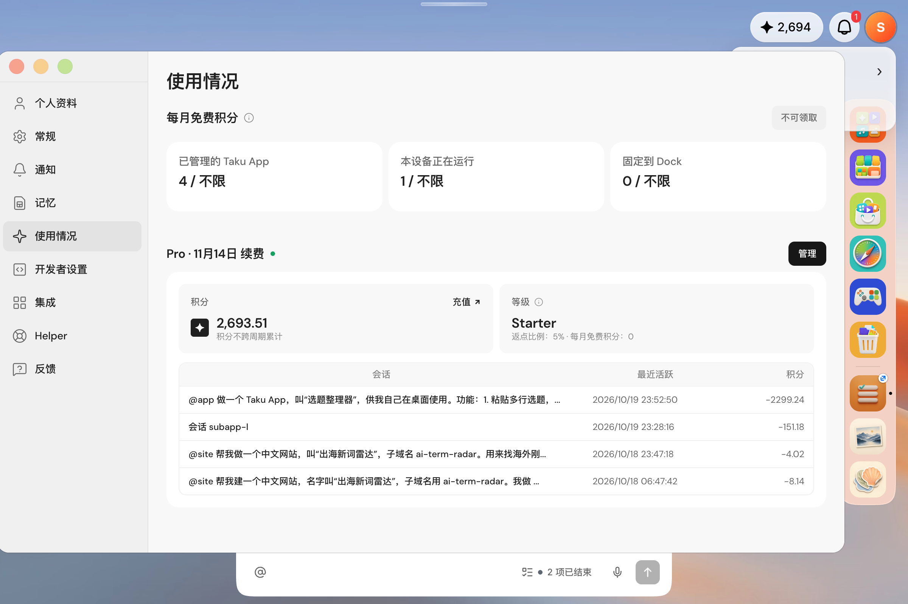
<figcaption>图 1｜使用情况页。下方表格按会话列出扣费，比右上角的余额更准。</figcaption>
</figure>

从这张账单能得出四条结论：

1. **失败的任务也照样扣钱。** 摘录卡片两次都没做成，一共扣了约 2,240 credits，按 1,000 credits 约 3.3 美元估算，大约 7.4 美元。
2. **档位低不等于省钱。** L2 那次失败后，Taku 自己一轮轮排查、重试，甚至另建了一个测试用的 App，越跑越贵。
3. **做一个成功的小工具，L3 约 2,300 credits，约 7.7 美元。** Free 账号第一个月只有 1,000 credits，不够做一次。
4. **长任务一定要盯着。** 做一个小工具超过 30 分钟还没交付，或者它反复说“重试”“换个思路”，就点对话里的 **停止**，再到使用情况页看扣了多少。停止后不再继续扣费。

### 1.4 省 credits 的习惯

1. **盯住长任务。** 这是最有效的一条。超过 30 分钟没交付，或者它反复重试，就点停止，见第 1.3 节。
2. **先看档位。** 改已有 App 用 L1 很便宜；L3 每一步最多可以扣到 900 credits，见第 10.2 节。
3. **先用免费的本地 App 熟悉界面。** 像 Sticker Studio 这种 “免费 · 本地运行” 的作品，安装时会扣十几到几十 credits，之后打开和筛选不需要调用模型。
4. **先小范围试。** 先要 3—5 条结果，满意了再放大。
5. **一次把需求说清楚。** 按第 4 节的 “目标、材料、输出、限制” 来写，返工最费额度。
6. **长任务模式按需开。** Nitro 会持续调研、构建、验证和修复，AI 工作引擎的 L3 投入也更多，消耗相应更高；简单任务用默认设置即可。
7. **自动化频率别定太高。** 先手动跑一次，看这一次花了多少，再乘以每月次数估算。
8. **任务卡住先停下来查原因**（第 8、15 节），不要连续点重试。
9. **注意谁付钱。** 别人通过你的 Site 使用付费能力时，扣的是访客自己的 credits；你在 Taku 里预览时，扣的是你的（第 13 节）。

## 2. 先分清这些名字

不用先学全部术语。你只需要根据“我最后想得到什么”选择入口。

| 名称 | 你可以拿它做什么 | 从哪里开始 | 得到什么 |
| --- | --- | --- | --- |
| 对话 / Agent | 研究问题、整理文件、调用工具、编写或修改项目 | 桌面底部输入框 | 本次任务的回答、文件或应用 |
| App | 使用一个有界面、可以反复打开的小工具 | 社区 / 应用库；创建时选 `@app` | 在 Taku 桌面里运行的应用 |
| Skill | 让 AI 按一套固定方法处理某类任务 | 输入框 `@` → 技能 | 可复用的指令、脚本和参考资料 |
| API | 为任务选择搜索、模型等具体能力 | 输入框 `@` → API | Agent 可调用的一项服务 |
| 集成 | 连接 GitHub、Notion 等外部账号服务 | 设置 → 集成；对话中引用 | 经过授权的外部工具能力 |
| 自动化 | 让一条明确的任务按时间触发 | 任务管理 → View → 自动化 | 一条计划任务及其运行记录 |
| Site | 把一个产品变成能发链接的网页 | `@site` 或外部 Agent 的 `taku-sites` | `你选的名字.taku.site` |
| Publisher | 把已有项目评估、整理并带入 Taku 发布流程 | Codex / Claude Code 等宿主中的插件 | Skill 发布包，或 App 迁移候选等 |
| Widget | 把日历、计划、应用等放在桌面上随时查看 | 桌面组件入口 | 桌面上的小块界面 |
| Helper | 可选的主动辅助、屏幕观察和定期检查 | 设置 → Helper | 按你选择的范围主动提供帮助 |

**App、Skill、Site 不是同一个东西。** 比如一个“每日资讯简报”可以同时有三种形态：Skill 规定去哪里找资讯、怎么核对来源；App 是你自己每天打开看结果的界面；Site 是发给别人、用浏览器就能看的网页。是否需要三种都做，要看实际用途。

官网和官方 X 还使用 Stack / Stax 来描述组合与分享工作流；现在的 [stax 页面](https://taku.ai/stax) 也承担 Sites / Publisher 入口。先按页面里的具体产物判断，不必把所有名称理解成一种固定文件格式。[官方 Stack 说明](https://x.com/TheTakuAI/status/2094321678373527937)

## 3. 第一次使用：先把一个现成 App 跑起来

这是最快理解 Taku 的办法，不需要先配置插件或模型 API Key。本节的每一步都在真机上走过。

### 3.1 下载、登录和认识桌面

1. 进入 [官网下载页](https://taku.ai/download)，选适合自己系统的版本。本手册使用 macOS；Windows 页面当前标注实验性质，界面和稳定性可能不同。
2. 用自己的账号登录，可以用 Google 或 GitHub 账号。登录后桌面上会出现新手引导卡片，下一小节带你走一遍。
3. 打开右上角头像 → **设置 → 常规**，确认版本。本文截图来自 3.1.123；版本不同，个别入口可能变化。
4. 回到桌面，先认三个地方：底部对话框、右侧应用栏、右上角额度 / 通知 / 头像。

<figure>
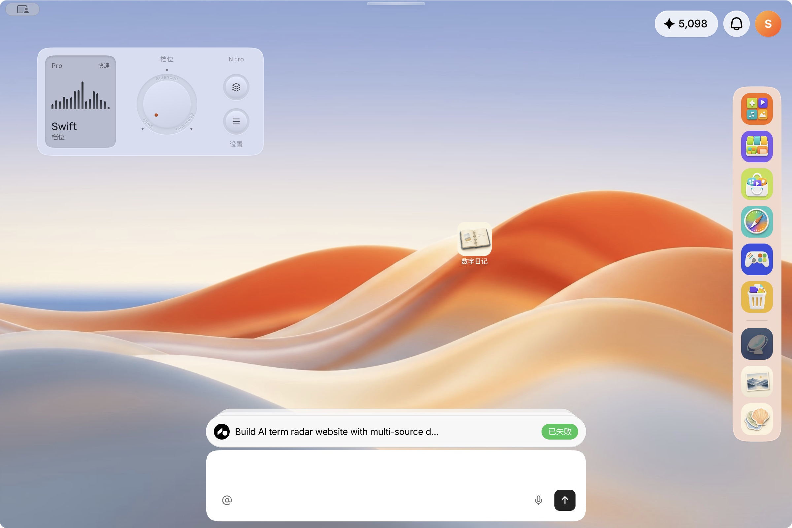
<figcaption>图 2｜Taku 桌面。右侧应用栏包含应用库、任务管理、社区、浏览器等；底部输入框是直接向 Agent 提需求的地方。</figcaption>
</figure>

### 3.2 跟着内置新手引导走一遍（12 步，约 3 分钟）

Taku 自带一个 12 步的新手引导，卡片会出现在桌面右侧，用红框指出下一步要点哪里。**建议第一次一定走完它**，走完你就会装应用、开应用，还会用“组合”做出第一个新应用。引导进行时，右上角一直有“跳过引导”按钮；不想做可以点它跳过，但第一次不建议跳过。

<figure>
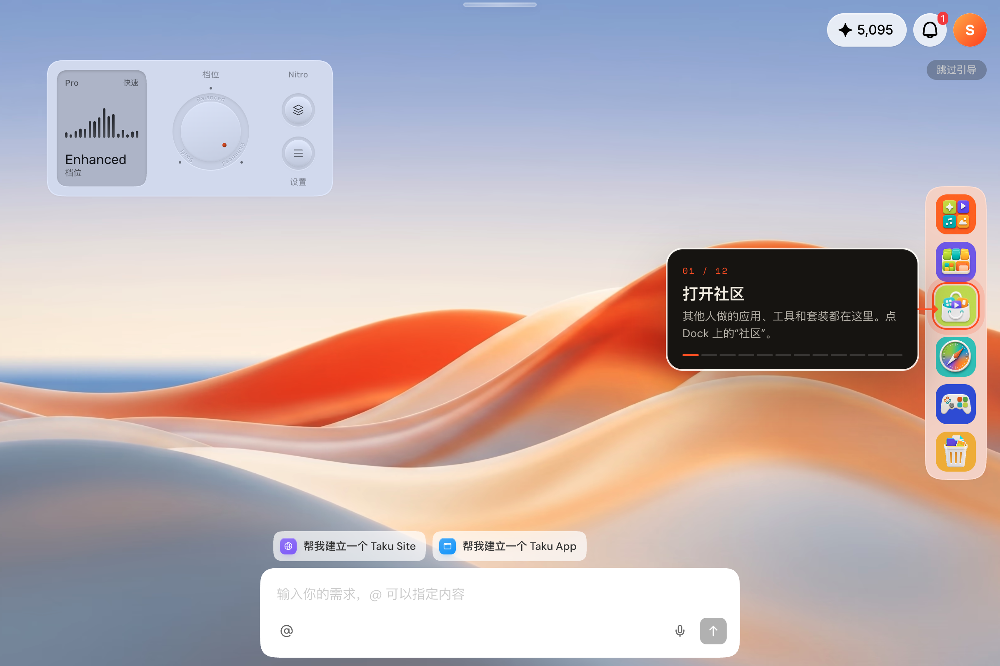
<figcaption>图 3｜引导第 1 步。左上角是档位组件，右侧竖排的一列图标叫 Dock，底部是对话框。卡片上的 “01 / 12” 表示总共 12 步。</figcaption>
</figure>

12 步分别是：

1. **打开社区**：点右侧 Dock 上的“社区”图标，就是那个购物袋样子的图标。
2. **点“发现”**：在社区左侧栏点“发现”。
3. **打开 Sticker Studio**：在列表里点这个贴纸应用的卡片，进入详情页。
4. **获取并运行**：点右上角黑色的“获取并运行”按钮。按钮下面“安装完成后运行”默认是勾上的，装好会自动打开。
5. **回到应用列表**：点左上角“返回应用列表”。
6. **打开 Travel Gallery**：这是一个旅行照片应用。
7. **安装 Travel Gallery**：同样点“获取并运行”。装好后，两个应用的图标都出现在 Dock 下方。
8. **把 Sticker Studio 拖进聊天框**：按住 Dock 上的贝壳图标，拖到屏幕底部的对话框里松手。
9. **把 Travel Gallery 也拖进去**：同样操作，对话框里会出现两个应用。
10. **点发送，组合它们**：直接点发送按钮。Taku 会弹出一张进度卡片，按“理解、构建、交付”三步，把两个应用组合成一个新应用。实测只用了 9 秒。
11. **拖到桌面**：把新应用从 Dock 拖到桌面上的虚线框里，以后在桌面就能直接点开。
12. **打开它**：点 Dock 上的新图标。看到“引导完成了”的提示，就全部完成。

<figure>
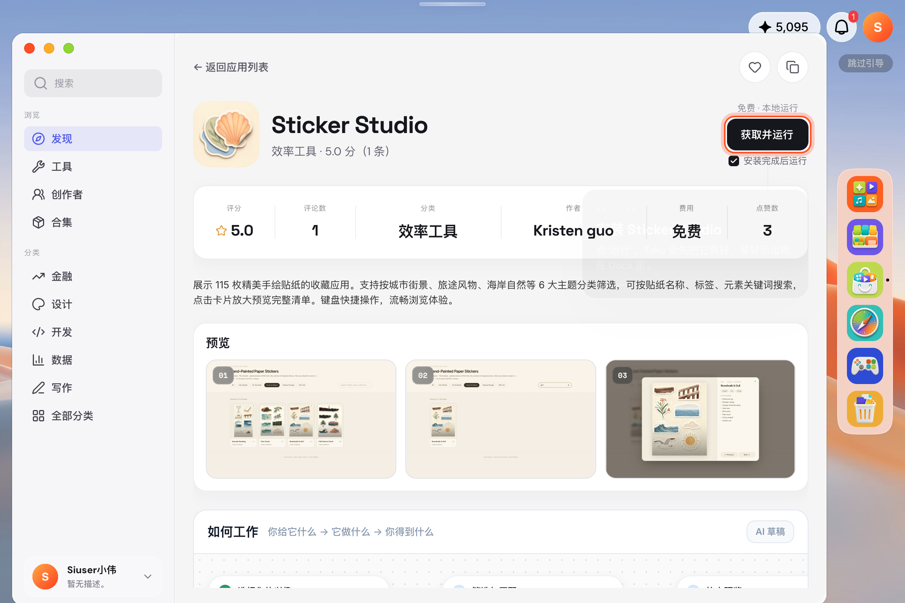
<figcaption>图 4｜第 4 步。详情页上方能看到评分、分类、作者和费用。“免费 · 本地运行”指这个应用本身免费、在你电脑上运行。</figcaption>
</figure>

<figure>
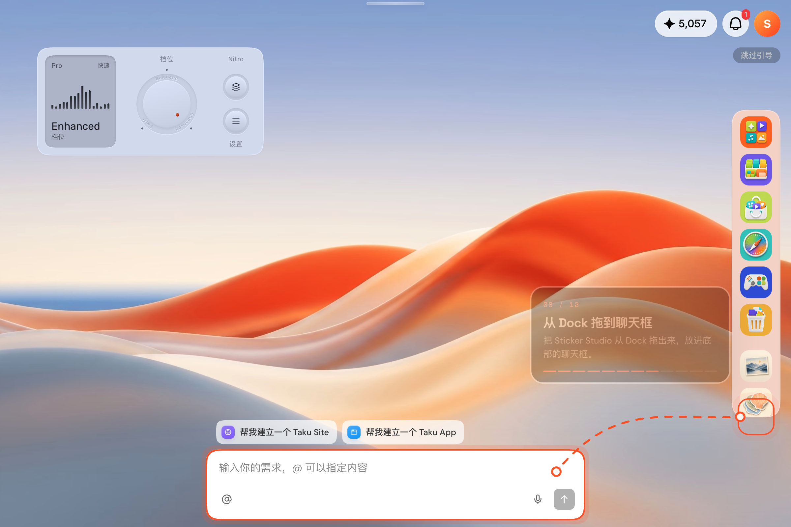
<figcaption>图 5｜第 8 步。红色虚线标出了从哪里拖到哪里。拖进对话框的应用，会作为这次对话的材料。</figcaption>
</figure>

<figure>
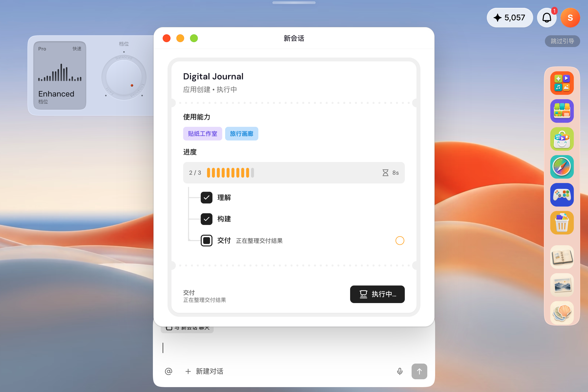
<figcaption>图 6｜第 10 步。卡片写明用到了哪两个应用，以及进行到哪一步。</figcaption>
</figure>

<figure>
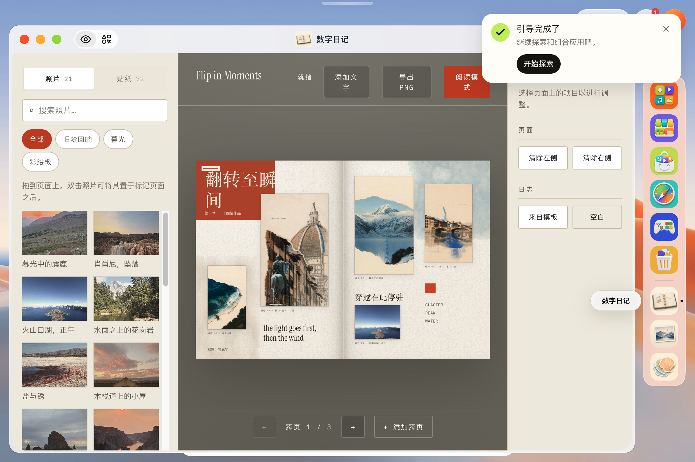
<figcaption>图 7｜组合出的“数字日记”。左边可以挑照片和贴纸，拖到中间的日记页上，能添加文字、导出 PNG。右上角提示“引导完成了”。</figcaption>
</figure>

走完引导后你要知道三件事：

- **“免费”应用安装时也会扣一点 credits。** 实测安装 Sticker Studio 和 Travel Gallery，余额分别减少了 25 和 13；组合那一步减少了 35。在 **设置 → 使用情况** 里，这次引导记为一个会话，共扣 151 credits。右上角的余额数字刷新有延迟，以使用情况页为准。
- **引导结束时会弹出“需要时，再开启灵动岛”的提示。** 灵动岛默认关闭，不开也不影响使用，以后可以在 **设置 → Helper** 里打开，见第 11.3 节。
- **做自己的 App 之前，先点对话框旁的“新建对话”。** 实测在引导留下的那个对话里直接让它做新 App，会显示“任务失败”。新建一个对话就正常了。

### 3.3 自己找、装、开、用

1. 点击右侧应用栏的 **社区**。也可以先在浏览器看 [Marketplace](https://taku.ai/marketplace)，实际安装 / 使用按客户端提示继续。
2. 在 Discover、分类或搜索中找一个感兴趣的应用。第一次可以选功能直观的免费工具。
3. **点标题或卡片进入详情**，先看介绍、创作者、运行方式和价格。
4. 未安装的作品点 **获取并运行**；已经装过的会显示 **打开**。
5. 打开后执行一个简单操作。不要只以“窗口出现了”判断成功，要看到结果跟着输入变化。
6. 关掉窗口后，到 **应用库** 找到它再打开，确认你知道下次从哪里进入。关闭 App 窗口时，Taku 会提示“关闭将停止应用进程”，并给你“最小化”的选择；想让它在后台继续跑，就选最小化。

<figure>
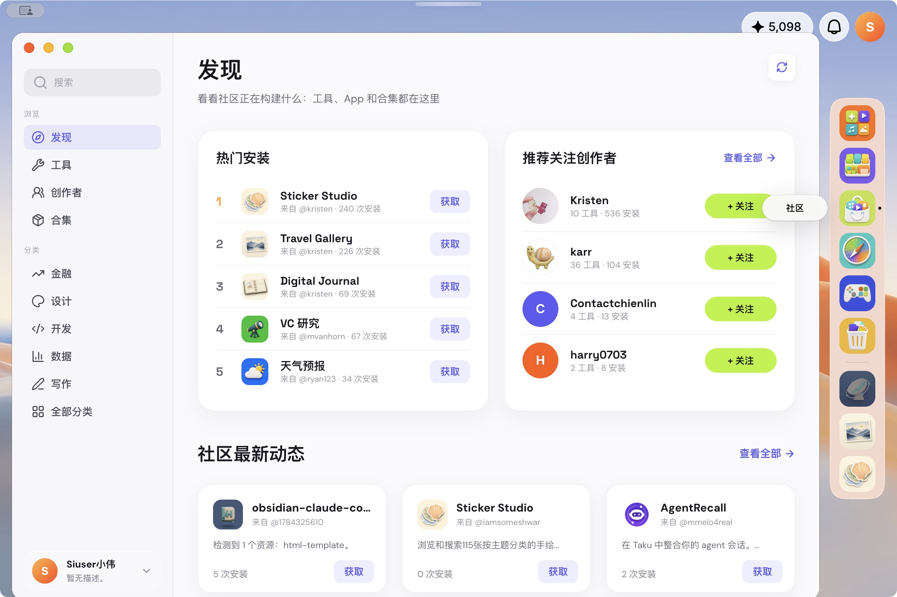
<figcaption>图 8｜社区负责发现作品。推荐位、分类和排行会变化，不需要和截图一模一样。</figcaption>
</figure>

<figure>
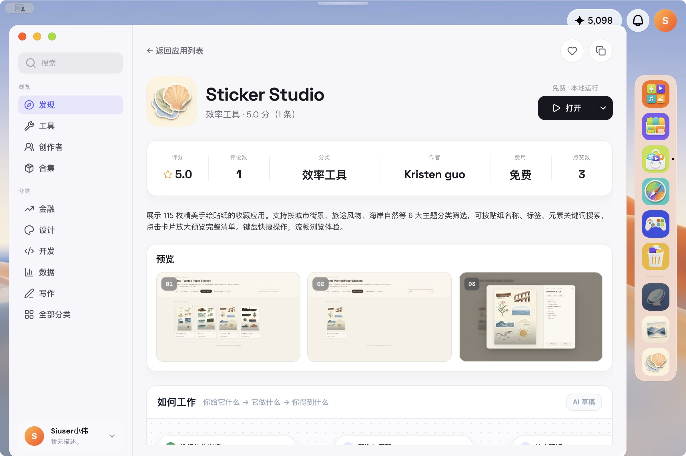
<figcaption>图 9｜已安装的应用，详情页按钮变成“打开”。“免费”只说明这个作品本身免费，不代表用它调用 AI 也免费。</figcaption>
</figure>

**我实际验证的例子：** 打开 Sticker Studio，选择 **Coast & Nature** 分类，列表变成 **4 / 18 sheets**。说明它是一个能操作、会更新结果的应用。你可以用同样方法验证自己的第一个 App；如果这个作品不再可用，就换一个简单的免费工具。

<figure>
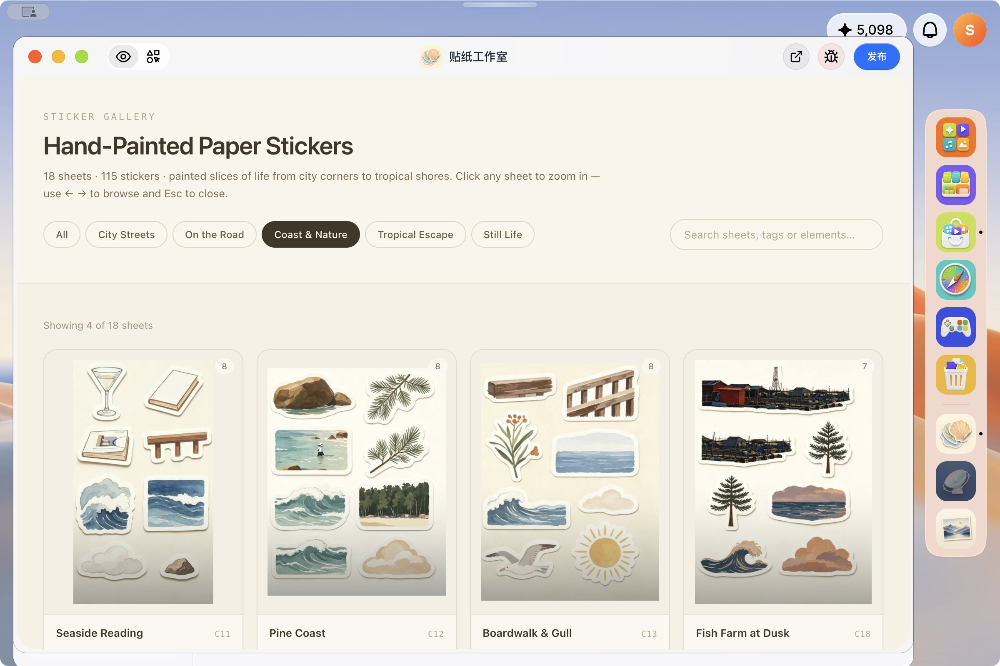
<figcaption>图 10｜真实运行结果：选了 Coast & Nature 分类后，列表只剩 4 组。</figcaption>
</figure>

**完成标志：** 你能从应用库重新打开一个 App，并让它完成一次有结果的操作。如果卡片可以打开、App 却空白或报错，先看第 15 节，不要连续重复安装。

## 4. 直接对话：把任务说到可以验收

对话适合先试一次需求。建议把输入写成四项：**目标、材料、输出、限制**。如果只说“帮我做个资讯简报”，AI 还得猜从哪里找、看多长时间内的、要不要去重、结果写成什么样。

可以先试这种有明确结果的小任务：

```text
帮我整理最近 24 小时值得内容创作者关注的 AI 新产品。
最多 5 项，每项包含：名称、发生了什么、对谁有用、原始来源链接。
优先官方发布，区分事件发生时间和文章发布时间。
找不到可靠来源就标记待核实，不要补写；先在对话里给结果。
```

搜索结果的质量和消耗，取决于当时调用的工具和你的档位。第一次先验收 3—5 条，比马上要求建一个完整系统更容易定位问题。

想处理本地材料时，可以在 `@ → 文件` 选择明确的文件，或使用客户端提供的附件入口。需要读取目录、运行脚本或调用外部账号时，先看它请求的具体范围。对话框允许你描述这些任务，不代表每项依赖已经配置好。

### 快速启动器：不用切回桌面也能提问

3.1.113 起有了 **快速启动器**。默认快捷键是 **Command + Option + T**，可以在 **设置 → 常规 → 快速启动器** 里改。在任何界面按下快捷键，就能搜索、启动 App，或直接提问；回答到一半可以停止，也可以转回主对话继续。习惯后，这是最快的入口。[官方版本说明](https://taku.ai/changelog)

### Planner、Builder、Nitro 怎么理解

Planner 可以理解为任务的规划与协调阶段；Builder 负责实现和构建。Nitro 是官方用于长任务的工作模式名称。它们并不是三种固定模型，也不能当成成功率或无限额度承诺。[官方版本说明](https://taku.ai/changelog)

普通使用先选清楚目标和材料。档位决定用哪些模型、花多少 credits，见第 10.2 节；任务没有完成时，去任务管理看原因，不要只盯着最后一句回复。

## 5. 输入框里的 @：给 AI 指定资源

点击输入框旁的 **@ 图标**，会看到全部、新建、应用、技能、API、集成、文件等分类。它的价值是明确告诉 Agent 这次使用哪个资源。

### 5.1 新建：App 还是 Site

点击 **新建** 或对应的介绍入口，当前界面会解释两种产物：

| 你的目标 | 选择 |
| --- | --- |
| 做一个自己在 Taku 桌面反复打开的工具 | Taku App / `@app` |
| 发一个网址，让别人用浏览器访问 | Taku Site / `@site` |

<figure>
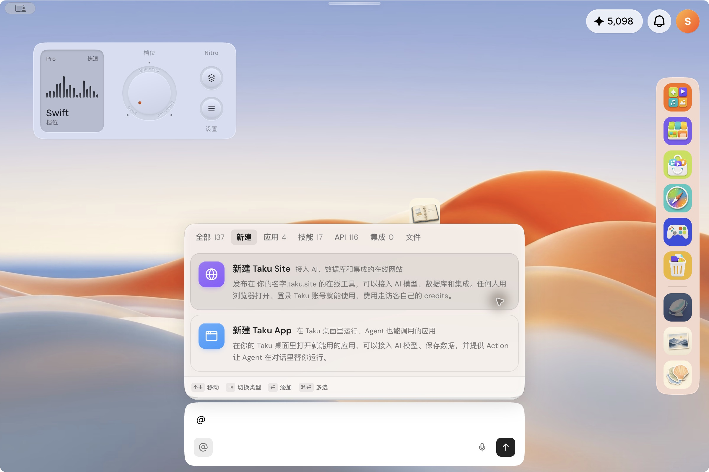
<figcaption>图 11｜先按使用场景选 App 或 Site。截图中的 Site 简介是概括；静态公开页面与需要登录、付费能力的页面还要分别配置，详见第 13 节。</figcaption>
</figure>

### 5.2 技能：指定工作方法

点 **技能**，搜索并选择已安装的 Skill，再说明本次任务。比如同样叫“研究”，一个 Skill 可能强调官方来源，另一个可能做跨平台收集；选对工作方法比只改模型更直接。

<figure>
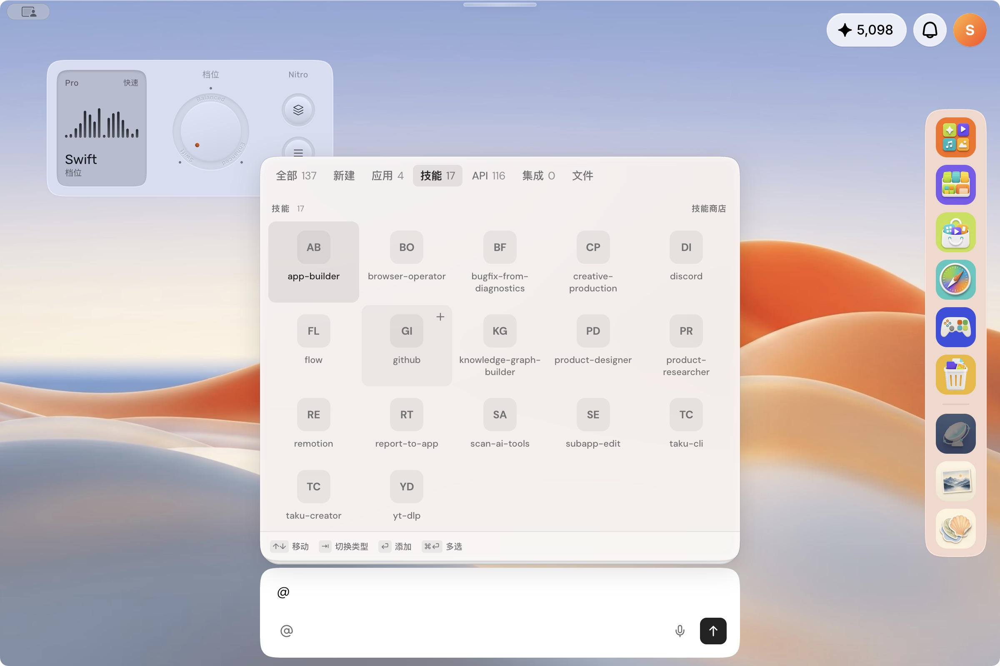
<figcaption>图 12｜技能列表取决于本机安装情况。出现一个技能，只能证明客户端发现了它；需要的 CLI、账号或环境仍要单独确认。</figcaption>
</figure>

### 5.3 API：指定服务能力

点 **API** 后搜索具体服务。本机搜索 `SerpAPI` 能出现相应结果，可将它加入对话。

```text
使用我选中的搜索 API，找出这个产品的官网、正式发布说明和定价页。
先返回链接及核对结果，遇到登录或额度问题直接说明。
```

<figure>
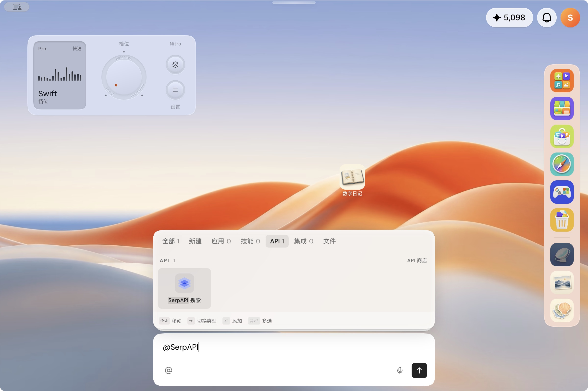
<figcaption>图 13｜API 是明确选服务的入口。桌面 API 目录与 Sites 能调用的集成目录不同，不能把这里看到的全部能力直接搬到网站端。</figcaption>
</figure>

### 5.4 应用：让 Agent 知道你指的是哪个 App

可以从 `@ → 应用` 选择已有 App；也可以进入应用详情，打开更多菜单 → **在 Agent 中引用**。界面解释为：把应用加入对话，让 Agent 调用它。

<figure>
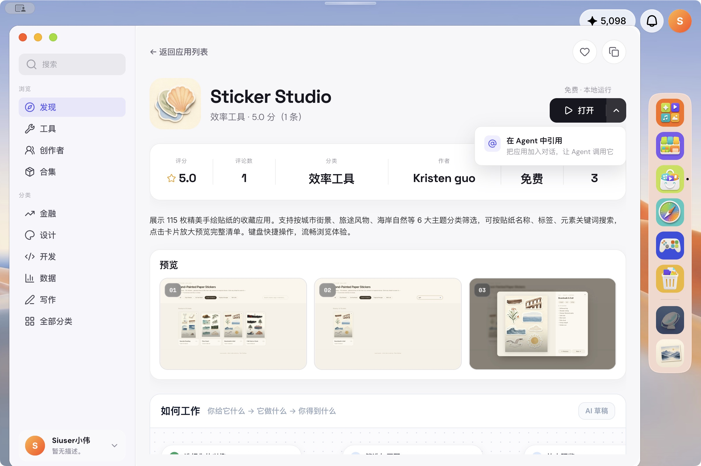
<figcaption>图 14｜引用能减少“你说的是哪个应用”的歧义。Agent 能具体调用哪些 Action，要看该 App 实际提供了什么；引用不等于任意内部功能都可自动操作。</figcaption>
</figure>

例如你可以说：“我指的是这个 App。先解释现有功能，再告诉我能否增加中文分类。”这比从零重新描述、意外生成另一个同名 App 更容易保持上下文。

## 6. 使用、修改和管理已有 App

### 6.1 修改前先决定改哪一份

社区作品的“免费”不自动代表你获得任意复制、改编和商用的权利。需要 Remix 或发布自己的版本时，先看具体作品许可。[Marketplace 许可说明](https://taku.ai/terms/marketplace)

对自己有权修改的 App，先引用它，再描述一个小改动。例如：

```text
基于我引用的这个 App，把分类名称改成中文。
保留现有功能和用户数据。先说明将修改哪一份应用，再执行并验证。
完成后重新打开更新后的应用，让我检查分类筛选是否仍然正常。
```

遇到“修改现有版本”与“生成副本”的选择，按你想保留原作还是直接维护自己的应用决定。

### 6.2 Design Mode 是什么

App 窗口中可以看到预览 / 设计模式入口。设计模式用于调整文字、颜色和布局。首次进入时，当前版本明确提示需要准备时间。

<figure>

<figcaption>图 15｜第一次进入设计模式会弹出确认框，提示需要一些准备时间。</figcaption>
</figure>

设计修改可以这样表达：“选中这个标题，把文字改成‘今日选题’，字号加大一级，其他区域保持原样。”涉及抓取逻辑、去重、数据库等功能变化，仍应清楚描述需求并验证，不能只靠看起来改好了。

### 6.3 应用出错、版本和窗口

App 窗口还有 **修复这个应用、独立窗口、发布** 等入口。出现错误时，先保留原错误信息；使用修复入口前看清将附带的诊断信息，再让 Agent 针对问题处理。

**修复时会发送什么：** 3.1.113 起，“修复这个应用” 默认附带运行日志和 App 信息，诊断截图只保存在本地。3.1.123 起，编辑 App 时会显示实现结构图，可以只让 Agent 修复其中某一部分，不用整个重做。[官方版本说明](https://taku.ai/changelog)

在应用库里，对已有 App 打开右键菜单，可以看到打开、固定、重命名、移动、回滚等管理操作。**回滚入口存在不等于所有 App 都有可恢复历史**，要看实际可选版本。先验收新版本，再清理旧数据。

## 7. 第一个自己做的 App：选题整理器

先做一个不联网、不调用 AI、不接外部账号的小工具。功能越简单，越容易看出问题出在哪里。**下面的过程和结果都是真机实测**，包括中途出错和怎么恢复。

**开始前先做两件事：**

1. **看一眼档位。** 打开 **设置 → 开发者设置 → AI 工作引擎**，看当前是 L1、L2 还是 L3。实测 Pro 账号默认是 L3 最高档，用它做成这个小工具花了 2,299 credits。L1、L2 便宜一些，但实测从零做新 App 都没成功，失败也扣钱，见第 10.2 节。不管用哪档，发出后都要盯着时间。
2. **点“新建对话”。** 如果刚走完新手引导，一定要先新建对话，否则会显示“任务失败”。

**操作步骤：**

1. 点对话框上方的 **帮我建立一个 Taku App** 快捷按钮，或者点 `@ → 新建 → Taku App`。
2. 粘贴下面的需求，点发送。
3. 等它构建。进度卡片会显示理解、构建、交付三个阶段。实测从发送到完成约 20 分钟，期间可以去做别的事。
4. 完成后应用会出现在 Dock 和应用库里，打开它，按后面的验收输入试一次。

```text
做一个 Taku App，叫“选题整理器”，供我自己在桌面使用。

功能：
1. 粘贴多行选题，一行一条，最多 100 条。
2. 去掉首尾空格、空行和完全相同的重复项。
3. 展示整理前后数量，并逐条列出结果。
4. 能一键复制整理后的文字、清空输入。
5. 这一版只在当前页面处理文字，不调用模型、不联网、不接外部账号。

中文界面，按钮清楚。完成后打开应用，验证去重、数量和复制功能。
```

**如果中途显示“连接异常”：** 实测第一次构建 38 秒后就断了，只建出一个空模板。不用重新开始，在**同一个对话**里回复下面这句，它会接着做完：

```text
继续完成这个应用，按我上面的需求把功能做完，完成后打开应用自己验证一遍。
```

**验收输入：**

```text
AI 新词雷达
  选题整理器
AI 新词雷达

Taku 入门
```

<figure>
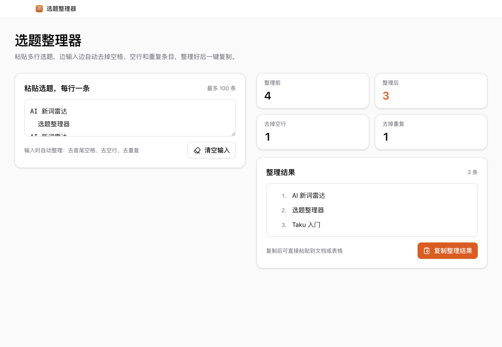
<figcaption>图 16｜实测结果。粘贴验收输入后，右侧立刻显示整理前 4 条、整理后 3 条，去掉空行 1 个、重复 1 个。</figcaption>
</figure>

**实测验收结果，全部通过：**

- 整理结果是 3 条：AI 新词雷达、选题整理器、Taku 入门。第二行前面的空格被去掉了。
- 统计显示：整理前 4，整理后 3，去掉空行 1，去掉重复 1。整理前只算有内容的行，所以是 4 不是 5。
- 点 **复制整理结果**，按钮变成“已复制 3 条”，粘贴出来确实是这 3 行。
- 点 **清空输入**，输入框、统计和结果全部归零。
- 不用点“整理”按钮，边输入边自动整理。这是 Taku 自己加的设计。

**实测中你会遇到的情况：**

- **它的中间回复可能变成英文。** 做到一半，Taku 的进度说明会切换成英文，最终做出来的应用仍然是中文界面。看不懂时，可以回复“请用中文说明进度”。
- **名字相近的已有 App 会被直接改掉。** 实测再让它“做一个选题整理器 L1”，它发现已经有选题整理器，就直接在原来那个上面改了名字，没有新建。想保留原来那个，就在需求里写明“新建一个，不要改已有的应用”。
- **它会自己测试。** 完成时 Taku 会说明它用自动化用例检查过哪些功能。但你仍要自己按验收输入试一遍，别只看它的说法。
- **费用比想象的高。** 这一个小工具在 L3 档位扣了 2,299 credits，按订阅价折算约 7.7 美元。做完记得到 **设置 → 使用情况** 看这次会话扣了多少。

<figure>
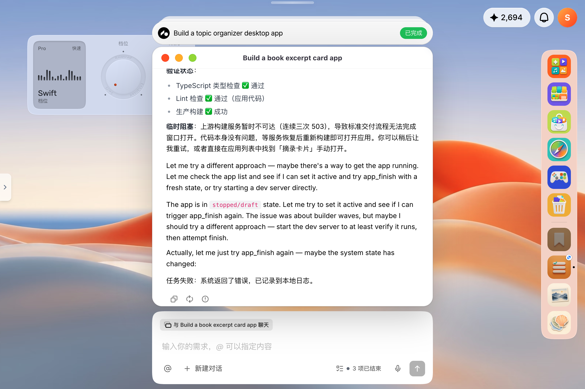
<figcaption>图 17｜做练习 2 时的失败画面。它说代码都写好了，但交付不了，最后显示“任务失败”。这种情况下回复“继续”也没救回来。</figcaption>
</figure>

如果验收不通过，回到同一个对话，贴出具体差异，比如“输入 4 行含重复时仍显示 4 条，预期是 3 条”。这比“你再优化一下”更容易修好。成功之后，再逐项增加收藏、保存记录、AI 评分等功能。

### 7.1 再做几个练习：从不用 AI 到用 AI

做通 “选题整理器” 以后，可以按难度继续练。下面的提示词都可以直接复制，发送前确认选的是 Taku App。参照选题整理器的经验，每做一个练习前先看一眼档位，做完到使用情况页记下花费。

**练习 2：读书摘录卡片**（只在本地处理，不调用 AI。实测用 L1 和 L2 各做了一次都没交付成功，见第 1.3 节，做之前先盯好时间）

```text
做一个 Taku App，叫“摘录卡片”。
我粘贴一段书摘，填写书名和页码，保存成一张卡片。
卡片列表按书名分组，可以搜索关键词、删除单张卡片。
关闭再打开后，卡片还在。不调用模型、不联网。
完成后打开应用，保存两张卡片，再关闭重开，确认卡片还在。
```

验收：关闭再打开 App 后，卡片还在，说明保存功能生效。

**练习 3：封面图生成器**（使用 Taku 内置的图像 AI，会消耗 credits）

3.1.102 起，Taku App 可以直接使用 Taku 的 AI 生成图片和视频，不需要自备 API Key。

```text
做一个 Taku App，叫“封面图生成器”。
输入一句文章标题，选择风格（简约、插画、摄影），生成 1 张 16:9 的封面图。
生成前显示预计消耗，生成中可以取消，结果可以下载。
先只做单张生成，不做批量。完成后用一个标题测试一次。
```

验收：可以取消；取消后不会重复扣费；结果能下载。生成前先看清预计消耗。

**练习 4：周报整理**（调用文本模型）

```text
做一个 Taku App，叫“周报整理”。
我把这周零散的工作记录粘贴进去，它整理成：本周完成、进行中、遇到的问题、下周计划四部分。
不编造我没写的内容，没写到的部分标注“无”。
可以一键复制结果。完成后用我给的示例记录测试一次。
```

验收：用一段故意漏掉 “问题” 的记录测试，对应部分应该显示 “无”，而不是编出内容。

### 7.2 让做好的东西能反复用、能给别人用

一次做成不难，难的是下次还能用、别人拿去也能用。官方博客 [把一次性任务变成工具](https://taku.ai/blog/reusable-ai-workflows) 给了 6 条检查项，做 App、Skill 或自动化前都可以对照一遍：

1. **把每次会变的内容当成输入。** 比如日期范围、文件、读者对象。说不清每次要换哪些内容，就还不适合做成工具。
2. **写清输出格式。** 几条、几句、表格有哪几列，而不是一句“帮我总结一下”。
3. **附一个真实例子。** 给一组真实输入和你满意的结果，比写一堆形容词有用。第 7 节的验收输入就是这个作用。
4. **加一条自检。** 告诉它结果必须满足什么条件，比如“每条都要带来源链接”。
5. **记下版本和日期。** 以后效果变差，才分得清是你改了需求，还是模型变了。
6. **写明依赖。** 用了哪个模型、要什么文件、连了哪些账号。只写需要哪种密钥，不要把密钥本身写进去。

博客里还有一个简单的检验办法：把工具交给一个同事，什么都不解释。他要问你问题才能用，就说明这些答案应该写进工具里。

另外两个常见问题：

- **在原对话里好用，换个新对话就不行。** 说明有些背景只在前面的聊天里说过。把这些背景写进需求，再到新对话里试一次。
- **模型更新后效果变了。** 记下当时用的档位和模型，变了以后用同一个例子重新测一遍。

## 8. 任务管理：知道工作卡在哪里

点击右侧 **任务管理**，再点 **View**，可以切换全部、最近、产物、自动化。Workspace 则帮助你在工作空间之间组织任务；桌面还提供新建、重命名和归档入口。

<figure>
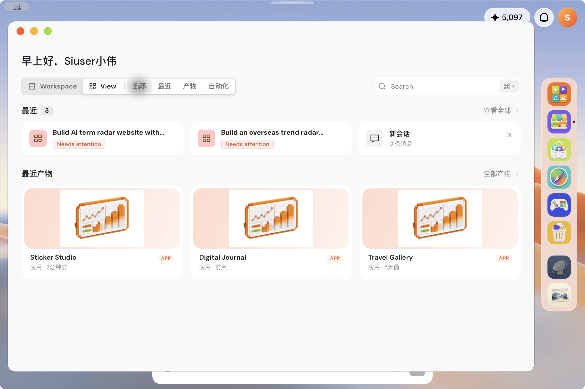
<figcaption>图 18｜任务管理能看到每个任务是待处理、失败还是已有产物。</figcaption>
</figure>

遇到任务迟迟没结果：

1. 先打开原任务，看它是在等待你、执行中，还是已经失败。
2. 有明确错误就保存错误原文，核对网络、权限、依赖或额度。
3. 已有产物时，先尝试打开产物，确认它究竟完成了多少。
4. 在原任务继续修复；只有确定要另做一个项目时才重新开始。

**“回答完了”“构建通过”“应用能用”“网站上线”是不同状态。** 做 App 要看到真实功能通过；做 Site 要看到平台确认可用，并打开实际网址检查。

## 9. 自动化：每天定时做一件明确的事

电脑休眠、关机或退出 Taku 后，定时任务不一定能执行，第一次用时先保持 Taku 开着。

### 9.1 从哪里创建

1. 点击右侧 **任务管理**。
2. 点击 **View → 自动化**。
3. 选择 **新建自动化**。
4. 填名称、触发器、指令、模型和通知。

<figure>
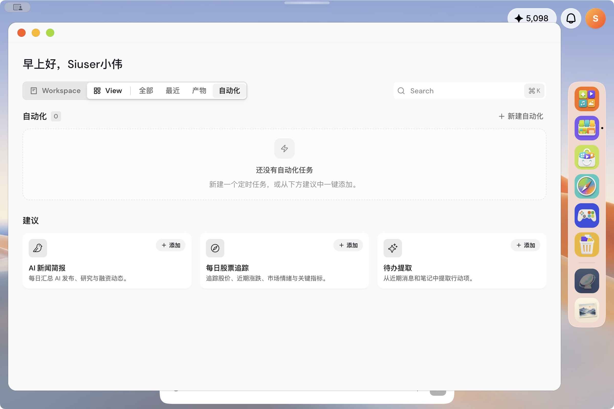
<figcaption>图 19｜自动化与普通任务在同一个任务管理里。截图中的自动化数为 0。</figcaption>
</figure>

触发器当前包括一次、每天、工作日、每周、每月、每年，以及自定义 **5 字段 Cron**。新手用“每天 + 时间”就够了。如果你常跨时区，创建后核对界面显示的下次执行时间。

<figure>
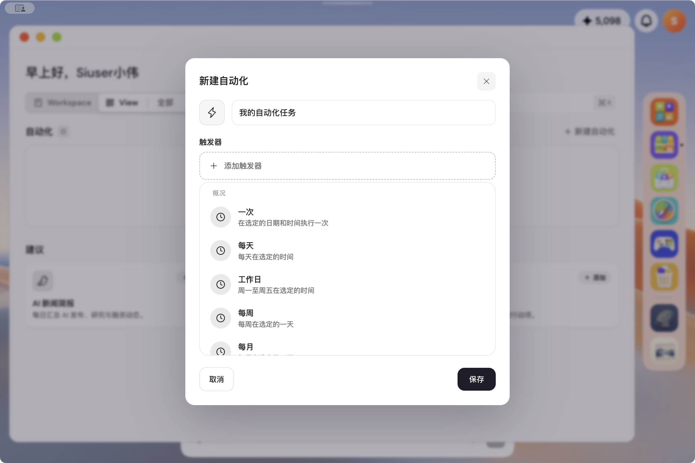
<figcaption>图 20｜先选自然语言周期，需要复杂排程时再用 Cron。</figcaption>
</figure>

### 9.2 一个可以照填的例子

名称：**每日 AI 新词简报**。触发器：**每天，上午 9:00**。

```text
整理过去 24 小时海外 AI 新模型、新产品和新工具，最多 5 项。
每项给出名称、发生了什么、原始来源链接；无法核实就标记待核实。
只在 Taku 中显示结果，不发送到外部平台。
```

<figure>
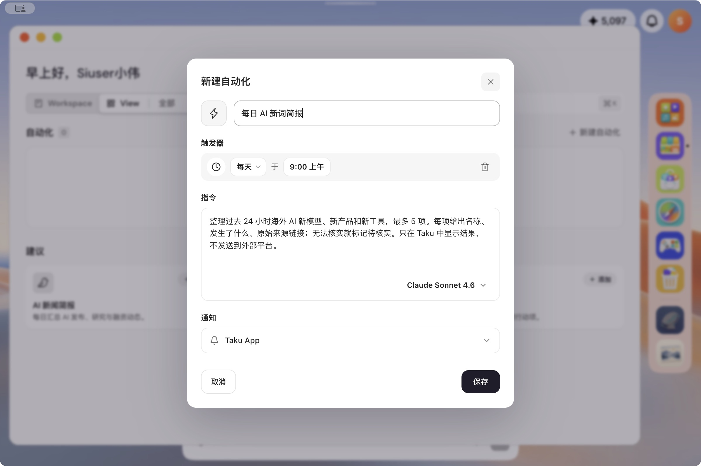
<figcaption>图 21｜填写示例。模型一栏可以按需要改，不必和截图一样。</figcaption>
</figure>

你自己使用时，先把同样的任务在普通对话里跑通一次，再保存自动化。保存后回列表确认计划存在、周期正确；首次执行后核对运行记录与结果。如果列表提供暂停 / 编辑入口，可在不需要时停用；按当前界面操作，不要重复创建同名计划。

当前表单的通知选项是 **Taku App / 关闭**。Bark、ntfy、Telegram 在设置中另配；不要把任务表单理解成已经接通飞书、微信或所有外部渠道。

### 9.3 关窗口、退出和后台运行

常规设置中，**关闭窗口时**有隐藏到顶部栏、每次询问、退出应用等选项。本机选的是隐藏到顶部栏。**关窗口与退出进程不同**；第一次验证本地计划时，先保持 Taku 运行并核对记录。其他执行环境的计划是否可在退出后继续，要按具体任务确认。

<figure>
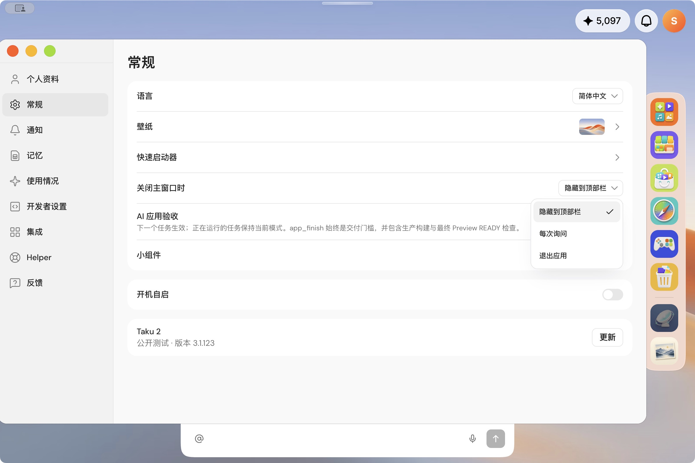
<figcaption>图 22｜关闭主窗口时的三种选择。电脑休眠、关机或断网时，定时任务不一定能补跑。</figcaption>
</figure>

## 10. 设置：新手先看哪几页

入口：右上角头像 → **设置**。建议先看常规、使用情况和通知，再按需求看开发者设置 / 集成 / Helper。

### 10.1 常规、账号与额度

常规页从上到下是：

- **语言**：简体中文或英文。
- **壁纸**：桌面背景。
- **快速启动器**：默认快捷键 Command + Option + T。
- **关闭主窗口时**：默认“隐藏到顶部栏”，见第 9.3 节。
- **AI 应用验收**：有“关闭（更快交付）”和“完整验收”两种。选完整验收，Taku 做完 App 会多花时间自己检查一遍，相应也会多花一些 credits；新设置从下一个任务开始生效。不管选哪种，交付前都会做构建和预览检查。
- **小组件**、**开机自启**。
- 最下面是版本号，本手册是 “Taku 2 公开测试 · 版本 3.1.123”，旁边有“更新”按钮。

个人资料页有套餐、邀请码、活动中心和退出登录。**使用情况** 页能看到套餐和续费日期、积分余额、本月即将过期的积分，以及每个会话扣了多少积分。做完任何一件事，都建议来这里看一眼。

<figure>
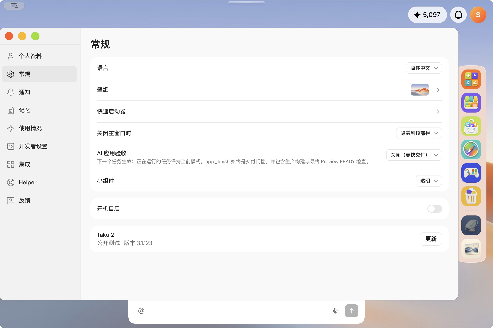
<figcaption>图 23｜新手先确认语言、版本和关闭行为。屏幕上的账号余额是示例，不是新用户赠送额度。</figcaption>
</figure>

**费用要分开看：** 订阅 / 账号额度、作品获取价格、实际模型或第三方调用费用，可能不是同一笔。一个免费本地工具可以只处理本地输入；另一个免费安装的 AI 工具，使用时仍可能消耗模型额度。执行前看页面报价或确认提示，执行后看使用情况。

各套餐的价格、credits 数量和省额度的方法，见第 1 节。

本手册不把旧活动帖或网页静态摘要当成当前报价。购买前以 [官方 Pricing](https://taku.ai/pricing) 与本人账号展示的实际周期、额度和费用为准。

### 10.2 Planner 模型与 AI 工作引擎

开发者设置里有 **Planner 模型、AI 工作引擎、本地模型、浏览器连接、Harness Inspector** 等入口。本机的 Planner 模型显示为 GLM 5.2。做 App 时实际用哪些模型，以下面的 AI 工作引擎档位为准。

<figure>
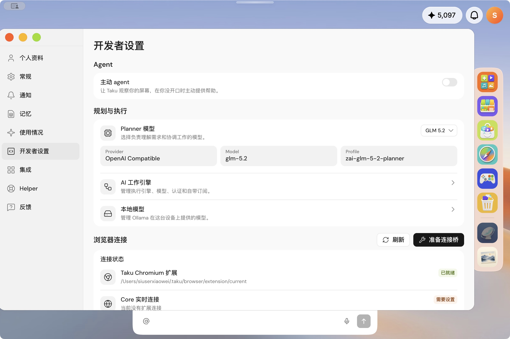
<figcaption>图 24｜“开发者设置”里既有模型选择，也有扩展和诊断。初学时不需要每一项都配置。</figcaption>
</figure>

**AI 工作引擎决定花多少钱，是新手最该看的设置。** 页面上有 L1、L2、L3 三个档位，改了之后，从下一个启动的任务开始生效。从 Taku 本地的配置文件可以看到，每个档位对应的模型如下：

| 档位 | 规划用的模型 | 动手做的模型 | 每一步最多扣 |
| --- | --- | --- | --- |
| L1 免费 | 豆包 Seed 2.1 Turbo | GLM 5.3 | 40 credits |
| L2 中档 | Claude Sonnet 5 | GPT-5.6 Luna | 36 到 300 credits |
| L3 最高 | Claude Opus 5 | GPT-5.6 Sol | 750 到 900 credits |

一个任务通常分成好几步，每一步单独计费。实测 **Pro 账号默认是 L3**，强度 xhigh，最多 6 个 Agent 同时工作；用它做第 7 节的选题整理器花了 2,299 credits。

怎么选：

实测结果（每档只测了一两次，仅供参考，见第 1.3 节的账单）：

- **L3** 从零做出了选题整理器，花了 2,299 credits。
- **L1** 改已有 App 很便宜，只花 25 credits；但从零做摘录卡片失败了，Taku 说是写代码的服务连续返回 503（服务暂时不可用）。
- **L2** 接手摘录卡片，跑了 1 小时没交付，花了 1,996 credits，最后手动停止。

所以建议是：

- **改文字、改颜色、给已有 App 加小功能**：先用 L1，便宜。
- **从零做新 App**：哪一档都可能失败，失败也扣钱。需求写小一点，发出后每隔十几分钟看一眼进度和使用情况页。
- **超过 30 分钟还没交付**：先点停止，不要让它一直重试。

**第一次切到 L1 要注意：** Taku 会先在后台下载 L1 专用的运行程序，约 120 MB，十几秒就能下完。如果切完马上发需求，可能会显示“任务失败：系统返回了错误”。等半分钟，点“新建对话”再发就正常了。

**桌面左上角的档位小组件也会跟着变：** L1 显示 Swift，L2 显示 Balanced，L3 显示 Enhanced。看一眼就知道当前是哪一档。

<figure>
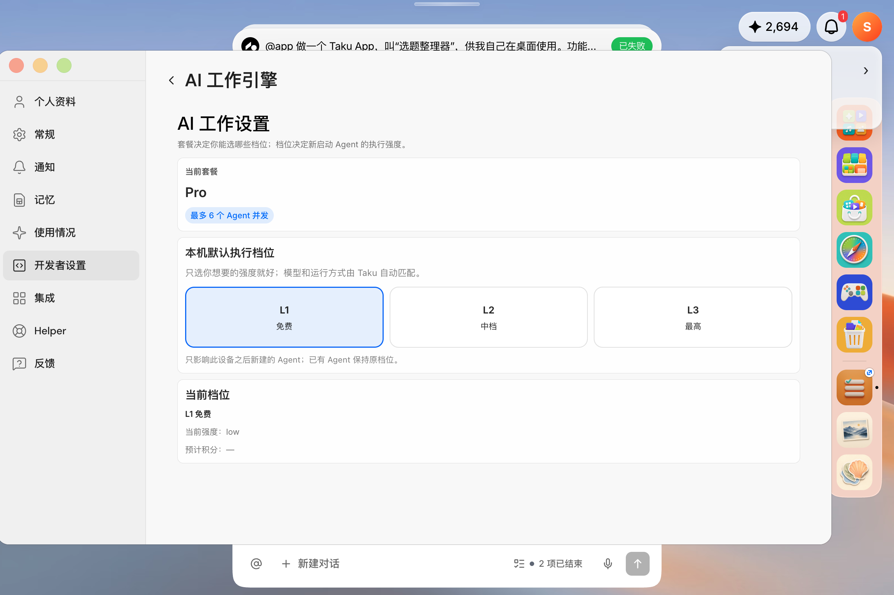
<figcaption>图 25｜切到 L1 后，当前强度显示 low。L2 是 medium，L3 是 xhigh。</figcaption>
</figure>

模型名称和每步上限来自 3.1.123 版本的本地配置，以后可能调整，以你客户端里显示的为准。

<figure>
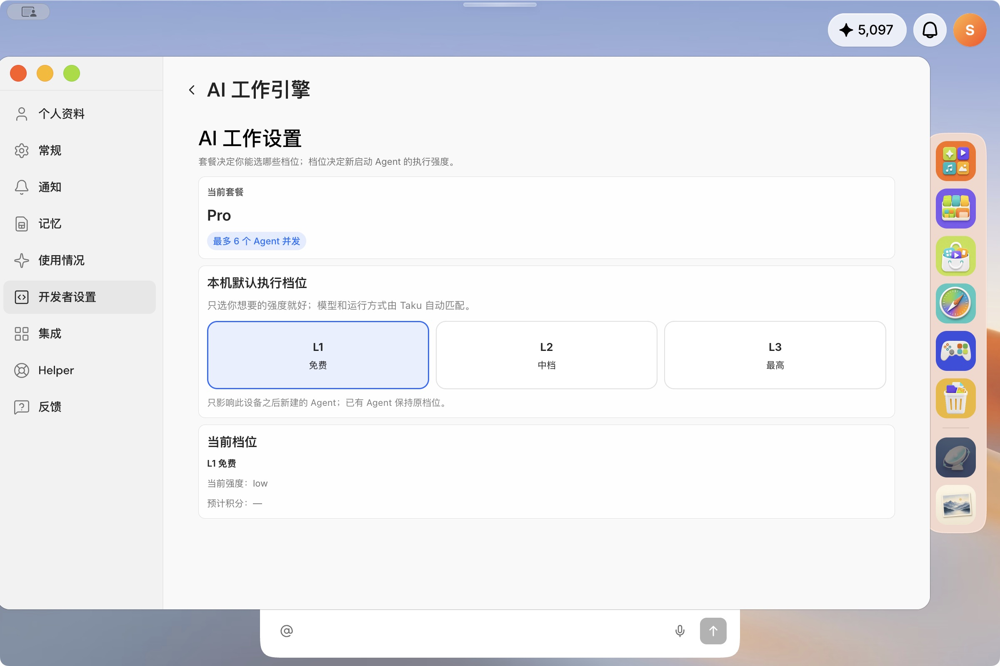
<figcaption>图 26｜AI 工作引擎页。能选哪些档位、最多几个 Agent 同时工作，取决于你的套餐。</figcaption>
</figure>

本地模型入口管理这台设备上的 **Ollama** 模型。它不表示你已经下载模型，也不表示所有任务、搜索和远程集成都能离线。确实需要本地模型时，再安装相应环境并验证一个小请求。

### 10.3 通知和手机推送

通知页可查看最近 30 天的通知，按分类、状态搜索。需要批准或处理的动作，按界面提示回通知面板操作，历史列表主要用于查看。

手机推送支持 **Bark（iOS）、ntfy（Android）、Telegram**。当前界面明确说明：由这台电脑直接发送，只在 Taku 运行时有效；通知标题和正文会发送到你选择的服务器。

<figure>
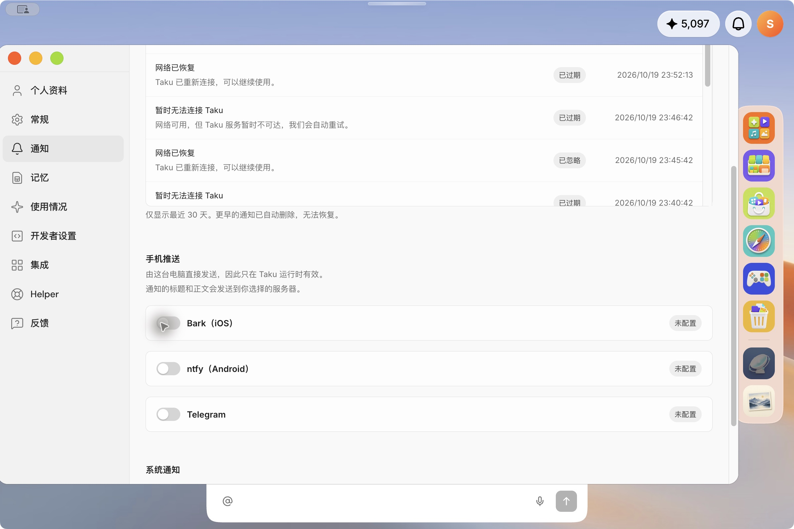
<figcaption>图 27｜Bark、ntfy、Telegram 三种手机推送，都要先在对应服务里准备好自己的账号。</figcaption>
</figure>

要配置时，选择你已有的服务，在客户端的受保护配置栏填写相应信息，再按界面测试。不要把真实推送密钥贴进公开应用、教程或发布包。具体收件端安装步骤按 [Bark](https://github.com/Finb/Bark)、[ntfy](https://docs.ntfy.sh/) 或 [Telegram](https://core.telegram.org/bots/tutorial) 官方说明核对。

### 10.4 “记忆”页面：这里实际是存储管理

这个名称容易误导。**本机当前“设置 → 记忆”展示的是存储占用、App 数据和 Workspace 归档等管理内容。** 没看到可直接编辑“我的长期偏好”的表单，不能把它写成一个已经验证的个人知识库管理器。官方隐私说明另外讨论了 Agent Memory；这个设置页不代表后台记忆能力的全部范围。[官方说明](https://taku.ai/privacy)

<figure>
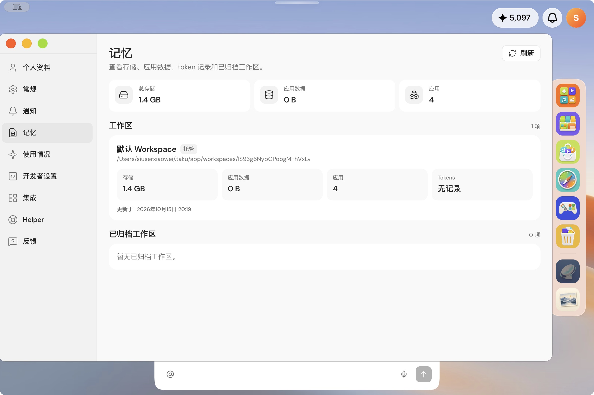
<figcaption>图 28｜本文按真实页面解释。存储清理与模型上下文、个人偏好、知识库是不同问题，删除前先确认对象和恢复方式。</figcaption>
</figure>

## 11. 集成、浏览器、Helper 和桌面组件

### 11.1 连接外部账号：目录多不等于全部已接通

打开 **设置 → 集成**，目录里有 1000 个应用。排在前面的 GitHub、Gmail、Notion、Google Calendar、Google Drive、Google Sheets、Figma、Linear、Sentry、Slack 用 OAuth 授权，而且**一开始只允许读**：比如 Gmail 能读邮件但不能发，Notion 能搜索阅读但不能改页面，GitHub 能读仓库但不能写入和部署。其余大多数条目标着“受限”。

1. 先找你真正需要的服务，查看条目是否可以添加。
2. 按“添加”进入该服务的官方授权流程，确认账号和权限范围。
3. 回到 Taku 确认连接状态，再在对话中选择 / 引用它。
4. 先用一个读取任务测试，例如“列出我指定文档的标题”。

<figure>
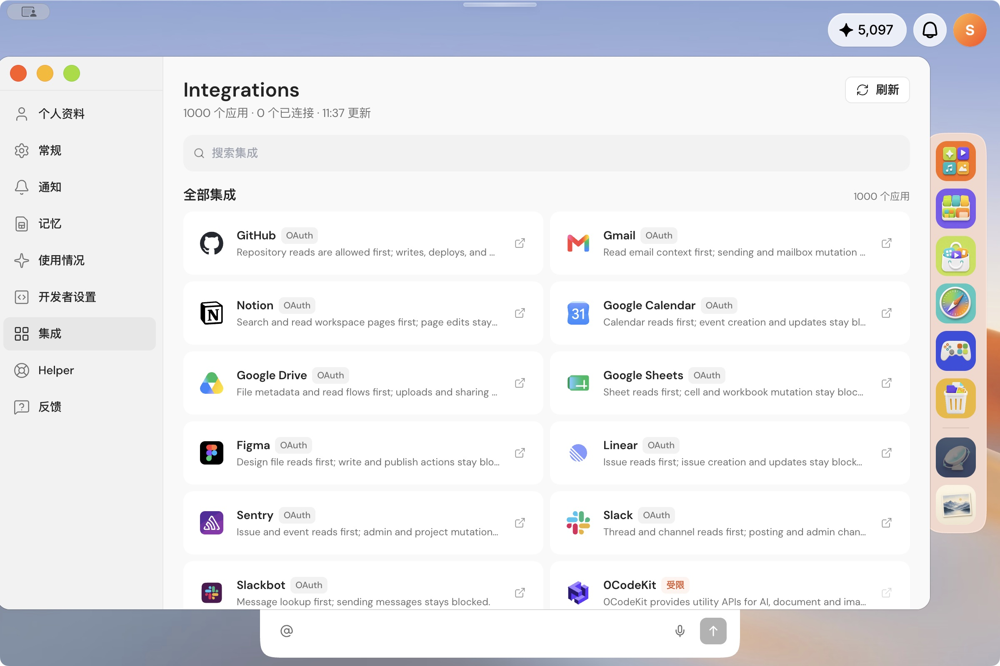
<figcaption>图 29｜只查看了目录，没有连接新的外部账号。当前界面强调读取优先，部分写入、发送、管理和部署类操作受限；不能承诺连接后就能任意写入。</figcaption>
</figure>

如果要发送邮件、发消息或修改外部记录，先确认这个连接器实际开放了该动作，以及你这次要操作的对象。服务出现在目录里、OAuth 成功、某个写入动作可用，是三个不同检查点。

### 11.2 浏览器桥接：需要额外连接

右侧有浏览器入口；另外，开发者设置还提供 Chromium 浏览器扩展 / Bridge 的准备和扩展目录入口。它们不是“已经自动接管你所有浏览器标签页”。

需要连接时，先在 Taku 准备扩展文件，再按页面说明在兼容浏览器的扩展管理页加载并连接；实际使用还要批准具体标签页。本机显示已准备扩展文件但未连接，没有继续加载或授权。释放标签页或撤回扩展授权可以结束对应访问。[官方隐私说明](https://taku.ai/privacy)

### 11.3 Helper：按需要开启的主动辅助

设置 → Helper 默认关闭。打开后，它会观察你当前在用的窗口，在合适的时候从屏幕顶部的“灵动岛”弹出一张建议卡片。主要选项有：

- **屏幕观察**：遇到密码管理、银行、聊天这类敏感应用会自动跳过。
- **用量上限**：默认每天最多推送 10 次，后台心跳每天最多用 16,000 token。
- **能力**：简单的一步任务直接在灵动岛里完成；需要工具、外部数据或多个步骤的，会交给 Planner 正式执行。
- **显示灵动岛**：默认关闭，只控制显示，不影响屏幕观察。

它会持续消耗 credits，也会看到你的屏幕，新手先不用开。

<figure>
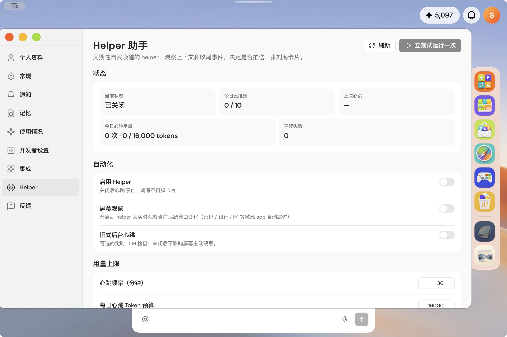
<figcaption>图 30｜Helper 默认关闭。它不是使用 App 或创建 Site 的前提。</figcaption>
</figure>

### 11.4 Widget、小游戏和其他辅助项

桌面组件菜单能看到我的应用、计划、日历、番茄钟、活动花园等项目。你可以按实际菜单添加常用信息；App 是否提供自己的 Widget，要看该应用能力。

右侧还能看到小游戏中心。官方 X 也发布过桌面伴侣实验和小游戏相关内容；它们属于辅助体验。不要把未来奖励预告当成已可兑现的收益，也不用为了做工具先参与活动。[小游戏相关官方帖](https://x.com/TheTakuAI/status/2110705384847741258)、[桌面伴侣实验](https://x.com/TheTakuAI/status/2108575510737645766)

## 12. 你已经在 Codex / Claude 做了项目：Publisher 怎么用

**本节依据官方 0.4.0 插件和发布文档。** 只用 Taku 桌面创建 App 时，不需要先装这个插件。

### 12.1 安装到熟悉的 AI 工具

官方组合插件叫 **taku-publisher**，包含 Publisher 和 Sites 两项 Skill。先确认有 Node.js 20 或更新版本：

```bash
node --version
```

Codex：

```bash
codex plugin marketplace add Taku-OS/taku-publisher --ref marketplace
codex plugin add taku-publisher@taku
```

Claude Code：

```bash
claude plugin marketplace add Taku-OS/taku-publisher@marketplace
claude plugin install taku-publisher@taku
```

装好后**新开一个聊天 / Agent 会话**，让宿主发现两项 Skill。如果命令与当前宿主不兼容，先查宿主版本和 [官方安装说明](https://github.com/Taku-OS/taku-publisher/blob/marketplace/README.md)，不要靠反复覆盖文件解决。

Cursor / 标准 Agent Skills 的固定版本安装器，按宿主选一条：

```bash
# Cursor
npx --yes --package https://github.com/Taku-OS/taku-publisher/releases/download/v0.4.0/taku-publisher-0.4.0.tgz taku-publisher install --host cursor --update
```

```bash
# 标准 Agent Skills 目录
npx --yes --package https://github.com/Taku-OS/taku-publisher/releases/download/v0.4.0/taku-publisher-0.4.0.tgz taku-publisher install --host agent-skills --update
```

0.4.0 是写作时的正式组合发行包；使用明确版本，避免旧的 latest 别名把你带到不同包。[官方发行页](https://github.com/Taku-OS/taku-publisher/releases/tag/v0.4.0)

### 12.2 不要一上来就“全部迁移并发布”

先让插件评估你的现有项目：

```text
使用 Taku Publisher，只读评估我指定的项目目录。
先告诉我核心功能、运行依赖、适合 Skill / Taku App / Site 的部分，
以及哪些功能需要改造。不要运行、修改、上传或发布。
我会在下一条提供准确项目路径。
```

不知道项目在哪时，也可以让 Publisher 列出最近在 Codex / Claude Code / Cursor 做过的候选，先选一个再评估。已知路径则直接提供绝对路径，更容易避免选错版本。

它可能建议已有 Skill、生成 Skill、App 迁移，或仅作参考。**扫描结果只是候选路线，要看真实代码与依赖。** 不能看到 Python 就宣布整个 Taku 无法运行，也不能看到一个网页就宣布可以不改直接上线。

需要登录时，在返回的官方浏览器页面完成，再回原聊天说“继续”。Token、验证码和回调信息不需要粘贴进聊天；注册条款和最终分发许可由本人在官方页面处理。

### 12.3 发布 Skill 的操作顺序

你可以这样要求：

```text
使用 Taku Publisher，把我选定的 Skill 准备成可发布版本。
保留原项目，在独立候选目录检查依赖、配置、权限和许可证，
完成安全审阅和打包，准备官方最终审阅页。公开提交前让我检查。
```

后续一般是：明确来源 → 准备文件 → 安全检查与打包 → 私有上传草稿 → 官方页面最终审阅 → 提交 → 查询远端状态。只有“打包成功”还不能说已上架；草稿、审核中、已发布要区分。[Publisher 官方 Skill](https://github.com/Taku-OS/taku-publisher/blob/v0.4.0/SKILL.md)

发布包里写清需要哪些配置、为什么需要；实际密钥留在受保护配置中。安装者仍可能需要自己的账号、环境和额度，不能把“可以安装”写成“无需任何条件就能跑”。

### 12.4 App 的桌面发布与外部迁移

自己创建的 App 窗口有 **发布** 入口；官方版本记录也有 App 发布与价格配置能力。点进去后按页面提示填写名称、预览、价格和许可。

外部项目迁移为 App 时，先做独立候选、适配、测试、构建和本地安装验收。Publisher CLI 注册的私有 App 草稿，不等于在桌面商店公开发布。可上架时，再按实际桌面 / 官方审阅流程核对名称、预览、许可、配置与价格，最后确认公开。

## 13. Site：让别人点一个网址就能用

**本节依据官方 Sites 0.4.0 文档和账号能力查询。** 官方 X 已明确展示从 Taku、Codex、Claude Code 带入项目并通过网址试用的方向。[2026-10-19 官方帖](https://x.com/TheTakuAI/status/2112153790849646607)

### 13.1 两个入口

你可以在 Taku 中选 **`@site`**，也可以在装好插件的 Codex / Claude Code 中使用 **taku-sites**。后者对你已有本地项目更直接；不用把源码手动粘贴成一长段对话。

第一次建议做简单展示页，确认完整链路，再接复杂业务：

```text
使用 taku-sites，做一个中文作品展示站。
包括首页、3 个项目卡片和关于我页面，先用我提供的公开文字。
先读取当前账号能力，在本地预览并验证页面和导航。
说明哪些测试使用模拟。现在不要发布；发布前让我填写并确认准确子域名。
```

### 13.2 从预览到发布

1. 检查 Sites 登录、账号资格和当前能力目录。
2. 在项目目录构建网站，按实际需求声明登录、存储和平台能力。
3. 启动本地预览，检查页面、输入、输出和错误提示。
4. 完成打包 / 契约验证，修复不兼容项。
5. 你提供准确子域名，检查是否可用。
6. 显示完整目标网址和本次构建摘要；你确认后再发布。
7. 等平台返回 ready / 可用状态，打开真实网址再验收一次。

**本地预览不等于线上可用。** 本地的登录、计费或存储可能使用模拟；静态验证通过也不能证明访客授权、真实写入和扣费成功。CLI 没有一个通用 `sites-preview` 命令，预览由 Agent 使用项目开发服务器完成。[Sites 官方流程](https://github.com/Taku-OS/taku-publisher/blob/v0.4.0/skills/taku-sites/SKILL.md)、[测试范围](https://github.com/Taku-OS/taku-publisher/blob/v0.4.0/skills/taku-sites/references/testing.md)

### 13.3 现在可以确认的能力边界

| 你想做的事 | 核对结果 |
| --- | --- |
| 静态公开页面 | 可以作为 Site 的一种形态；不应一概说所有页面都必须登录 |
| 登录与个人数据 | 有相应登录 / 存储机制，需要正确声明与授权 |
| 平台数据库 | 提供 Sites 存储能力，需要在项目里声明 |
| 搜索、图片、视频 | 实时目录里有 Airbnb、SerpAPI 搜索、图片编辑、图片生成、视频生成五类集成 |
| 桌面全部 API 搬到 Site | 不能保证；网站端要重新核对 Sites 实时目录 |
| 原样托管 Python 后端、任意爬虫、Cron | 当前 Sites 契约没有证明这条通用托管路线，需要另评估后端 / 调度架构 |
| 装好插件就有全部权限 | 不成立，资格、scope、容量和 credits 都由当前服务端状态决定 |

Sites 是有平台边界的网站运行环境。**Sites 的技术限制不能外推到整个 Taku 桌面 Agent。** 检查本机已安装程序的工具注册和技能导入逻辑：桌面 Agent 有文件与 shell 工具，可以通过本机环境调用脚本；这不证明自带完整 Python 环境或所有依赖。网站发布则要看网站契约是否支持这条数据链路。

API、账号集成和 MCP 也不是同一层能力。本文没有核实可供新手配置独立 MCP 服务器的完整界面流程，不能拿 `@ → API` 菜单充当 MCP 已配置成功的证据。

调用托管付费能力时，公开 Site 的供应商调用使用已登录访客自己的 Taku credits；Taku 预览由站长承担相应 credits。具体报价、预留和结算按当前接口与用户确认执行。[能力与计费文档](https://github.com/Taku-OS/taku-publisher/blob/v0.4.0/skills/taku-sites/references/capabilities.md)、[存储文档](https://github.com/Taku-OS/taku-publisher/blob/v0.4.0/skills/taku-sites/references/storage.md)

Sites 文档存在历史内测描述与较新正式说明的差异。当前正式说明支持普通已登录账号，已有账号的只读资格查询也允许访问；仍须以自己账号的实时查询为准，不能根据邮箱后缀猜权限。[正式发布状态](https://github.com/Taku-OS/taku-publisher/blob/main/docs/release-0.4.0-sites-ga.md)

## 14. 把已经做好的项目搬进来：分三关走

很多人是在 Codex、Claude Code 或 Cursor 里做过一个小工具，比如每天抓资讯的脚本、一个整理表格的网页，想放到 Taku 里用或分享给别人。这条路可以走，但**“别人能打开一个网页”和“工具每天能稳定跑出正确结果”要分开验收**。前者是界面和分享；后者还涉及数据来源、依赖、去重、定时、存储和出错恢复。

建议分三关推进：

1. **单次跑通。** 先复制一份项目，在副本里关掉对外发消息、调用付费服务这类会产生实际后果的功能，手动跑一次，核对结果。不要直接拿正在用的那份来试。
2. **做成自己的工具。** 确认依赖都能装上，再做成 Taku App 或 Skill。连续跑两次，检查有没有重复结果；然后再按第 9 节加一条自动化。
3. **分享给别人。** 需要网页入口时再做 Site。先想清楚：网页只是展示已有结果，还是让访客自己点按钮触发一次新的运行？后者每次都要花钱，见第 13 节的“谁付钱”。

第一步交给 Publisher 只读检查，可以照抄这段：

```text
使用 Taku Publisher，只读检查我指定的项目目录。
先还原它实际做了什么：数据来源、运行入口、Python/Node 依赖、
需要的密钥、定时方式、去重方式、结果存在哪里、界面与通知。
分别评估：在 Taku Agent 里运行、做成 Taku App 或 Skill、做成 Taku Site。
逐项说明哪些能直接用、哪些要改造、哪些目前做不到。
先不要修改、安装、上传或发布。我会在下一条给出项目路径。
```

拿到这张对照表，再决定走哪一条路。

## 15. 遇到问题，先按现象排查

| 现象 | 先检查什么 | 怎样判断恢复 |
| --- | --- | --- |
| 做 App 时立刻显示“任务失败” | 是不是在新手引导留下的对话里发的需求 | 点“新建对话”，在新对话里重发，能正常开始构建 |
| 构建中显示“连接异常” | 是否只建出了空模板 | 在同一个对话回复“继续完成这个应用”，它会接着做完 |
| 右上角余额和预期对不上 | 余额刷新有延迟 | 到 设置 → 使用情况 看每个会话的实际扣费 |
| 做个小工具花了上千 credits | 档位；任务是不是在反复重试 | 超过 30 分钟没交付就点停止；改小需求后再试 |
| 刚切到 L1 就“任务失败：系统返回了错误” | L1 运行程序还没下载完 | 等半分钟，新建对话再发 |
| 让它做新 App，它却改了已有的 App | 是否有名字和功能相近的 App | 需求里写明“新建一个，不要改已有的应用” |
| 找不到手册里的入口 | 当前版本、中文 / 英文名称；新会话是否已加载插件 | 能找到同一类入口，不要求坐标完全一致 |
| 点 Get 没反应或出现错误 | 是否已安装、是否要登录、作品状态、网络与额度 | 应用库出现作品且能打开，避免重复购买 |
| App 窗口空白 | 等待状态、原任务错误、修复入口；保留错误原文 | 实际输入能得到正确输出 |
| 任务一直等 | 原任务是否等待你、权限、网络、依赖或额度 | 状态更新且可查看产物 / 明确失败原因 |
| 输入 @ 没弹菜单 | 先点击输入框旁 @ 图标，再按分类选择 | 选中的资源作为引用加入对话 |
| Skill 能看到但跑不动 | CLI、账号、PATH、运行依赖是否真实存在 | 用一条最小任务验证该能力 |
| 插件装了 AI 找不到 | 新开会话，检查实际加载的两个 Skill 和版本 | Agent 能读取对应 Skill，知道正确命令 |
| 浏览器登录完仍等待 | 回原聊天继续，检查同一个授权请求 | 已授权状态通过，而不是重复开窗口 |
| 集成目录里有服务却不能写 | 条目是否受限、授权 scope、实际工具动作 | 读取成功后，再单独确认所需写入是否开放 |
| 定时没执行 / 手机没收到 | Taku 是否运行、计划是否保存、时间、记录、推送配置 | 先看到执行记录，再验证通知送达 |
| 打不开、加载慢、请求超时 | 客户端是否是最新版；系统代理 / PAC 设置（3.1.123 起客户端会遵循） | 社区和对话能正常加载 |
| 文件传不上去 | 文件是否超过 20 MB（3.1.123 起会在上传前拦截） | 压缩或拆分后上传成功 |
| 额度不足 / 402 | 实际余额和本次费用 | 本人决定补额度或缩小需求后再试 |
| 403 / 404 | 当前账号、资格、目标地址和客户端 / CLI 版本 | 服务端给出明确成功状态；不凭报错猜全站下线 |
| 429 / 配额限制 | 返回的等待时间与哪一种配额 | 按实际恢复条件重试，避免连续空耗 |
| 网站显示发布中 | 查询同一次发布状态 | 平台返回可用后，真实网址通过功能检查 |
| 本地好、线上登录或保存坏 | 是否用了模拟、scope、授权和真实 SDK | 在真实站点完成一次授权与数据往返 |
| 发布按钮灰色 | 文件包、安全报告、图标、许可和必填项是否齐全 | 查远端状态补缺项，不必立即重做全部流程 |

## 16. 一张使用路线表

| 你现在想做什么 | 下一步 |
| --- | --- |
| 我还没懂 Taku 的价值 | 按第 3 节走完新手引导，再自己打开一个现成 App 试一次 |
| 我想让 AI 做一次研究 / 整理 | 按第 4、5 节，写目标与验收结果，选择材料 / 工具 |
| 我想反复使用自己的小工具 | 按第 7 节，先做一个无外部依赖的 App |
| 我想每天定时执行 | 先手动跑通，再按第 9 节创建并验证自动化 |
| 我想用已有 Codex / Claude 项目 | 按第 12 节装插件，先只读评估具体项目 |
| 我想给别人一个能用的网址 | 按第 13 节做 Site，先预览，确认目标后发布并验收 |
| 我想知道要花多少钱 | 按第 1 节，先用 Free，再按实际消耗选套餐 |
| 我担心隐私和数据 | 按第 17 节，开启屏幕观察、浏览器扩展前先看清范围 |
| 我想发布作品给别人用 | 先看第 18 节的收益预期和发布清单，再走第 12、13 节 |
| 我想把别处做好的项目搬进来 | 按第 14 节分三关：单次跑通、做成工具、再分享 |

### 第一天 30 分钟清单

1. 确认电脑是 Apple Silicon 芯片的 Mac，下载并登录（第 0、3 节）。
2. 到 **设置 → 常规** 看版本号，并按需切换中文。
3. 走完内置的 12 步新手引导，装两个免费 App，再组合出一个新 App（第 3.2 节）。
4. 点输入框旁的 @，看一遍各个分类（第 5 节）。
5. 到 **设置 → 开发者设置 → AI 工作引擎** 把档位调到 L1 或 L2（第 10.2 节），点“新建对话”，再照抄第 7 节的 “选题整理器” 提示词，做出第一个 App。
6. 打开 **任务管理**，找到刚才的任务和产物（第 8 节）。
7. 到 **设置 → 使用情况** 看这半小时用了多少 credits（第 1 节）。
8. 想好要不要关闭训练数据的使用（第 17 节）。

第一天只需达成三件事：**会找和使用一个 App；知道自己的需求该选 App、Skill 还是 Site；能从任务管理找到结果与错误。** 之后再配置自动化、外部账号和发布。

## 17. 隐私、授权与作品许可：开启功能前先知道

**本节依据 2026 年 10 月 19 日的 [隐私说明](https://taku.ai/privacy) 和 [Marketplace 条款](https://taku.ai/terms/marketplace) 整理，只是要点概括，不是法律意见。** 有疑问以原文为准。

### 17.1 和你的数据有关的设置

| 项目 | 默认状态 | 你需要知道的 |
| --- | --- | --- |
| 内容用于改进服务和训练模型 | **默认可能使用** | 不想被使用，发邮件到 support@taku.ai，主题写 “AI Training Opt-Out”。只对之后的数据生效。可识别身份的原始个人信息、屏幕数据和浏览器扩展数据，不用于训练通用模型 |
| Agent Memory | 可选功能 | 开启后会保存偏好、摘要和观察记录，用于跨任务、跨会话。支持时可以查看、修改、删除，也可以关闭 |
| 屏幕观察（设置里的 Helper，隐私说明里称 Proactive Agent） | **默认关闭** | 需要系统的录屏权限。会尽量遮住密码、验证码和银行卡号，但官方明确说这 “不是保证”。关掉后只停止以后的采集 |
| 浏览器扩展 | 需要你同意，并逐个批准标签页 | 被批准的标签页里，它能读网址、标题、页面内容、截图和表单，也能替你点击、输入和提交。不读取浏览器保存的密码，不收集完整浏览历史 |
| 外部账号集成 | 由你主动添加 | 撤销授权只会阻止以后的访问，已经取得的数据不会自动删除 |
| 卸载客户端 | — | 不一定删除本地所有文件，也不会删除云端账号里的数据。要删除数据，发邮件到 support@taku.ai，主题写 “Privacy Request” |

开启屏幕观察、浏览器扩展、Agent Memory 前，先确认它们能看到什么。屏幕上有敏感信息时，先关掉屏幕观察。

### 17.2 获取别人的作品：你得到的是许可，不是所有权

- **“免费” 不等于你可以改了再发布或商用。** 只有作者明确选择了默认社区许可，你才可以修改、发布和商用。即便如此，也不能把几乎没改的内容当作竞品转卖，不能使用作者的名字和商标，并且要尽量保留署名。官方原话是：价格为零本身不代表选择了这个许可。
- **已经获得的副本不会被收回。** 作者下架作品或改价，不影响你已经拿到的许可。但这不保证作品永久托管或持续更新。恶意软件、侵权等严重问题除外。
- **复制下来的作品是快照。** 原作者以后更新，你的副本不会自动同步。创始人在 Product Hunt 上回应过这个问题，表示正在研究更好的更新方式。
- **付费作品是一次性扣 credits，不是订阅。** 运行时调用模型的费用另外计算。
- **退款**：重复扣费、权益没到账、交付失败、和介绍严重不符，都可以申请。发邮件到 support@taku.ai，附上 App 标识、账号邮箱和大致交易时间。卸载不等于退款；安装失败时先用同一账号重试，不要重复购买。

### 17.3 安装第三方作品前，先看这三项

1. **权限和数据说明**：它会读你的哪些文件、连哪些外部账号。
2. **需要什么条件**：是否需要你自己的账号、密钥或额度。
3. **许可**：只自己用，还是允许改编和再发布。

## 18. 创作者：发布、定价和收益的真实预期

### 18.1 能发布什么、从哪里发布

| 想发布的东西 | 入口 | 说明 |
| --- | --- | --- |
| 自己做的 App | App 窗口里的 **发布** | 3.1.123 起可以设为免费，或用 credits 定价；预览图分三个阶段自动生成；已发布的 App 有收益分成入口 |
| Skill / Stax | Codex、Claude Code、Cursor 里的 Taku Publisher | 见第 12 节 |
| 网站 | `@site` 或 taku-sites | 见第 13 节 |

Pricing 页说明，**发布自己的 Stax 从 Standard 套餐开始**。发布者须年满 18 岁。

### 18.2 收益：现在还很早期

- 收益以 credits 计算。[Publisher 条款](https://taku.ai/terms/publisher) 写明：没有统一的分成比例，不保证销量，也不承诺现金支付；如果将来开放提现，会另外公布规则。
- 2026 年 10 月 19 日的 Marketplace 页面显示，收益排行靠前的创作者分别约有 4,670 credits（约合 $15.57）和 5,230 credits（约合 $17.43，此人发布了 920 件作品）；安装量第一的 Sticker Studio 是 242 次。
- 结论：**现在发布作品，更适合用来积累作品集和反馈，不适合当作收入来源。**

### 18.3 活动：Bounty、Stax Card 与排行榜

- **[Bounty](https://taku.ai/events/bounty)（长期开放）**：有人发布需求并质押 credits，开发者提交方案，社区投票，最佳方案获胜。10 月 19 日页面上有 2 个悬赏，目标都是 1,000 credits，已筹集分别为 0 和 100。
- **Stax Card**：由 Publisher 根据你本机的使用记录生成的 AI 身份卡，内容包括构建者类型、等级、成就和作品集。卡片先私密生成，你审阅后再决定是否分享。[Stax 页](https://taku.ai/stax) 称每生成一张卡可领 10 美元的 GLM 5.3 额度。
- **排行榜挑战**：分为 AI Burn 和 Stax Creators 两个榜单。创作者分数 = 有效发布作品数 × 0.4 + 有效下载量 × 0.6。奖品有机器狗、iPhone、Mac mini 和 AI 额度等，但挑战时间官网仍写着 “待定”，以正式公告为准。**发布 Site 不会自动参加排行榜。**

### 18.4 发布前检查清单

参考官方博客 [如何分享 AI 工作流](https://taku.ai/blog/how-to-share-ai-workflows)：

1. **删除敏感信息**：检查提示词、配置文件、`.env`、请求头，删掉 API Key、令牌、密码、webhook 地址和个人邮箱。如果真实密钥曾被分享出去，马上更换。
2. **列出依赖**：写清测试时用的模型、连接的账号、本地脚本和需要的文件。
3. **写清输入和输出**：各写一行，说明别人要提供什么、能得到什么。
4. **选好许可**：说明别人可以怎么用。
5. **附一组示例**：给出一组真实的输入和对应输出，方便别人验证。

## 19. 版本更新速览：最近新增了什么

下表摘自 [官方更新记录](https://taku.ai/changelog)，只保留对新手有用的内容。本手册的截图来自 3.1.123。

| 版本 | 日期 | 对你有什么用 |
| --- | --- | --- |
| 3.1.83 | 2026-09-04 | 新用户有引导式首次任务；AI 可以创建并发布 Taku Sites；免费账户可同时运行的 App 从 1 个增加到 2 个 |
| 3.1.84 | 2026-09-04 | 恢复 Google、GitHub 登录 |
| 3.1.87 | 2026-09-05 | AI 会推荐相关的社区 App 和 Skill 作为参考，你也可以选择从零开始 |
| 3.1.90 | 2026-09-07 | App 可以同时有窗口和桌面 Widget，二者共享数据；新用户的 Dynamic Island 默认关闭 |
| 3.1.101 | 2026-09-11 | 设置页重做；通知历史，以及 Bark、ntfy、Telegram 手机推送；原 Enhanced Mode 改名为 **Nitro**；Builder 失败后由 Planner 接手纠偏 |
| 3.1.102 | 2026-09-15 | **App 可以直接用 Taku 的 AI 生成图片和视频，不用自备 API Key**；Google、GitHub 登录不再要求另设密码；macOS 与 Windows 稳定版发布 |
| 3.1.113 | 2026-09-18 | **快速启动器**：自定义快捷键，随时搜索、启动 App 或直接提问；@ 菜单支持最近使用、搜索和多选；修复 App 时默认附带日志，诊断截图只保存在本地 |
| 3.1.119 | 2026-09-24 | 选中图片后可以直接编辑；输入框新增 “创建 Taku App / Taku Site” 快捷入口；新手引导缩短为两步 |
| 3.1.120 | 2026-09-30 | 会话校验更严格；客户端版本太旧时会提示更新 |
| 3.1.123 | 2026-10-15 | 编辑 App 时显示实现结构图，可以只修复指定部分；App 可免费或用 credits 定价发布；**支持系统代理和 PAC**；超过 20 MB 的文件会在上传前被拦截 |

## 20. 新手常见问题

**Taku 免费吗？**
可以免费开始：第一个月 1,000 credits，之后每月 500。安装免费应用会扣十几到几十 credits，打开使用一般不扣；让 AI 生成、搜索、构建会扣得多。实测用最高档 L3 做一个小工具就花了 2,299。详见第 1 节。

**我的电脑能装吗？**
Apple Silicon 芯片的 Mac 可以。Windows 是实验性预览版。Intel Mac 和 Linux 目前没有安装包。

**能离线用吗？**
不能，需要联网。设置里的本地模型（Ollama）只管理本机模型，不代表整个 Taku 可以离线工作。

**有中文界面吗？**
有。本手册的截图就是中文界面，在 **设置 → 常规** 里切换语言。部分社区作品本身只有英文。

**需要会写代码吗？**
不需要。使用现成 App、用自然语言做 App 都不用写代码。只有通过 Publisher 把已有项目带进来时，才需要用到 Codex、Claude Code 这类工具。

**能用我自己的 OpenAI / Claude API Key 吗？**
Pricing 页的 Developer 方案写明支持自带模型和 API Key。普通套餐默认使用 Taku 提供的模型服务，不需要自己配置。

**在国内网络下打不开、加载慢怎么办？**
3.1.123 起，客户端会遵循系统代理和 PAC 设置。先把客户端升级到最新版，再检查系统网络设置。

**我的对话和文件会被拿去训练模型吗？**
默认可能会用于改进服务和训练。不希望被使用，按第 17 节的方法发邮件申请退出。

**别人的免费 App，我改一改能再发布吗？**
要看作者选的许可。“免费” 本身不代表允许改编或再发布，见第 17.2 节。

**我装的 App，作者更新后会自动同步吗？**
不会。你拿到的是当时的快照。

**credits 用不完会累积吗？**
订阅额度不累积。加购的 credits 有效期 12 个月。

**发布作品能赚钱吗？**
目前按 credits 记录收益，不承诺现金，市场也还很早期，见第 18 节。

**怎么退款？**
发邮件到 support@taku.ai，附上 App 标识、账号邮箱和交易时间。卸载不等于退款。

**做一个 App 要多久？**
实测用 L3 做成一个简单小工具约 20 分钟。但也遇到过跑了 1 小时还没做成的情况，所以要隔一会儿看一眼，超过 30 分钟就考虑停止。新手引导里的“组合”只用了 9 秒，因为它是拿两个现成应用拼起来。

**做 App 时它说“任务失败”或“连接异常”怎么办？**
“任务失败”先点“新建对话”再重发；“连接异常”在同一个对话回复“继续”。见第 7 节和第 15 节。

**截图和我看到的界面不一样？**
先到 **设置 → 常规** 看版本号。Taku 更新很频繁，同类入口能对上就行，不必要求位置完全一致。

## 21. 附录：研究范围、验证记录与官方资料

### 21.1 这份手册验证到哪里

| 层级 | 完成情况 |
| --- | --- |
| 实机入口 | 桌面、@ 分类、应用库 / 社区、任务视图、App / Site 创建入口、设计 / 修复 / 发布入口 |
| 实机功能 | 走完 12 步新手引导，安装 Sticker Studio、Travel Gallery 并组合出数字日记；从零做出选题整理器，去重、统计、复制、清空全部验收通过；记录每一步的 credits 扣费 |
| 表单验证 | 自动化周期、模型 / 通知字段；填写示例后取消，未保存或运行 |
| 设置检查 | 逐页查看个人资料、常规、通知、记忆、使用情况、开发者设置、集成、Helper、反馈；从本地配置读出 L1、L2、L3 对应的模型和每步上限 |
| 官方流程核对 | Publisher 0.4.0 安装、Skill 准备 / 审阅、App 迁移、Sites 构建 / 预览 / 发布 |
| 只读平台检查 | 已有账号 Sites 资格与实时能力目录；没有调用付费接口 |
| 官网资料核对 | 2026-10-19 核对 Pricing、Changelog、隐私说明、Marketplace / Publisher 条款、Stax、Bounty、Launch Quest 页面与 Product Hunt 页面（第 0、2、17—20 节） |
| 文档为主的部分 | 设计模式修改、自动化定时执行、外部账号授权、手机推送、公开发布、访客计费：这些会动到真实账号或公开内容，按官方文档和客户端界面编写 |

这里的“功能研究”覆盖官网公开主要模块和当前客户端可见入口。它不表示逐一测试了所有社区作品、模型和连接器；目录变化或账号差异需要按同样方法复核。

### 21.2 建议收藏的官方入口

- [官网](https://taku.ai/) / [下载](https://taku.ai/download)：开始使用。
- [Marketplace](https://taku.ai/marketplace)：找作品、看详情。
- [Changelog](https://taku.ai/changelog)：核对功能与版本变化。
- [Pricing](https://taku.ai/pricing)：费用入口；最终核对本人账号。
- [Sites / Stax](https://taku.ai/stax)：外部项目与网站分享入口。
- [Launch Quest](https://taku.ai/events/launch-quest) / [Bounty](https://taku.ai/events/bounty)：新手优惠与悬赏活动。
- [官方博客](https://taku.ai/blog)：工具对比与工作流分享方法。
- 客服与隐私申请：support@taku.ai。
- [Publisher 官方安装](https://github.com/Taku-OS/taku-publisher/blob/marketplace/README.md) / [0.4.0 发行包](https://github.com/Taku-OS/taku-publisher/releases/tag/v0.4.0)。
- [隐私说明](https://taku.ai/privacy) / [Marketplace 许可](https://taku.ai/terms/marketplace) / [Publisher 说明](https://taku.ai/terms/publisher)：连接、使用和分发时按需要查阅。

### 21.3 官方 X：用来理解方向，操作以客户端和文档为准

| 日期 | 主题 | 能支持什么 |
| --- | --- | --- |
| 2026-08-26 | [Marketplace](https://x.com/TheTakuAI/status/2092495839763870010) | 汇集应用、Agent、Skill 和工作流的方向 |
| 2026-08-27 | [Run](https://x.com/TheTakuAI/status/2092866627700412792) | 降低运行现成工具的门槛 |
| 2026-08-28 | [Remix](https://x.com/TheTakuAI/status/2093224534946279828) | 在已有工作流上加入工具与上下文 |
| 2026-08-31 | [Stack](https://x.com/TheTakuAI/status/2094321678373527937) | 组合可复用能力 |
| 2026-09-04 | [Publish](https://x.com/TheTakuAI/status/2095812844826828837) | 发现、运行、改编和发布作品的方向；不能据此承诺当前收益 |
| 2026-10-03 | [Sites 演示](https://x.com/TheTakuAI/status/2106366640472637467) | 分享有输入和结果的网页体验 |
| 2026-10-19 | [Taku / Codex / Claude → Site](https://x.com/TheTakuAI/status/2112153790849646607) | 把工具通过网址交给浏览器访客试用 |

所有截图都是真机界面，没有概念图。
